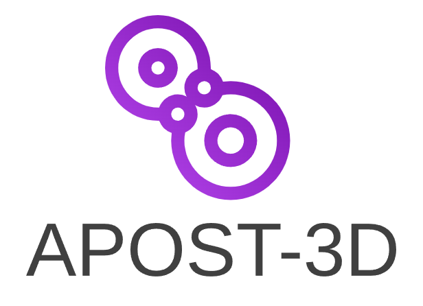

# APOST3Dview

APOST3Dview is a free program for looking at molecules, their orbitals and densities, and the results of the chemical bonding analyses of [APOST-3D](https://github.com/mgimferrer/APOST3D), and for making publication figures and videos of them. It runs on Windows, macOS and Linux.

It is made for two kinds of users:

- APOST-3D users: APOST-3D writes a results file (`<job>.apost.json`) next to every run. APOST3Dview opens it and shows what APOST-3D computed on the molecule: fragments, charges, bond orders, local spin, effective oxidation states, effective fragment orbitals (EFOs), OSLOs and the energy decomposition (IQA). It can also prepare APOST-3D's input for a calculation.
- Anyone with a `.fchk`, `.molden` or `.cube` file: APOST3Dview draws molecular orbitals, total and spin densities, and correlated densities with their natural orbitals straight from the wavefunction file, without an external cube step, and shows `.cube` files of any program.

Figures are made in the program too, ready for a paper: a whole grid of orbitals in one image, all seen the same way, each with its caption (the FOLI of an OSLO, the occupation of an EFO), and related molecules side by side in exactly the same orientation, even when they come from separate calculations turned differently: [align them on a few matching atoms](molecule.md#aligning-related-molecules) and every panel shows them alike. See [Figures and videos](figures.md).

## How this guide is organized

- [Getting started](install.md): installing, the first start, and [a five-minute tour](tour.md) with the examples that come with the program.
- Tasks: one chapter for each thing you do, from [looking at a molecule](molecule.md) to [figures and videos](figures.md) and [sessions](sessions.md).
- Reference: [file formats and what is validated](formats.md), [mouse and keyboard](controls.md), [troubleshooting](troubleshooting.md), [limitations](limitations.md), and [getting help](help.md).

In this guide, the names of buttons, windows and menus are written as the program shows them, in bold: **Open**, **Surfaces**, **Show**. Menu entries that come from the results file are in italics: *Fragment charges (Lowdin)*. Keys are written like <kbd>Esc</kbd>.

## Relation to APOST-3D

APOST3Dview is a sister project of APOST-3D with its own code (written in Rust). The two are coupled only through files: APOST3Dview writes APOST-3D's input (`.inp`), and reads the `.fchk` APOST-3D reads and the results file it writes. Which analysis does what, and which keyword asks for it, is explained in [APOST-3D's documentation](https://github.com/mgimferrer/APOST3D); this guide explains how to see the results.

## Citing APOST3Dview

APOST3Dview doesn't have its own publication yet. Until it does, please cite the APOST-3D paper if you use it in your work:

> P. Salvador, E. Ramos-Cordoba, M. Montilla, L. Pujal and M. Gimferrer, *APOST-3D: Chemical concepts from wave function analysis*, J. Chem. Phys. 2024, 160, 172502. DOI: [10.1063/5.0206187](https://doi.org/10.1063/5.0206187)

The same is in the program's **About** window.
