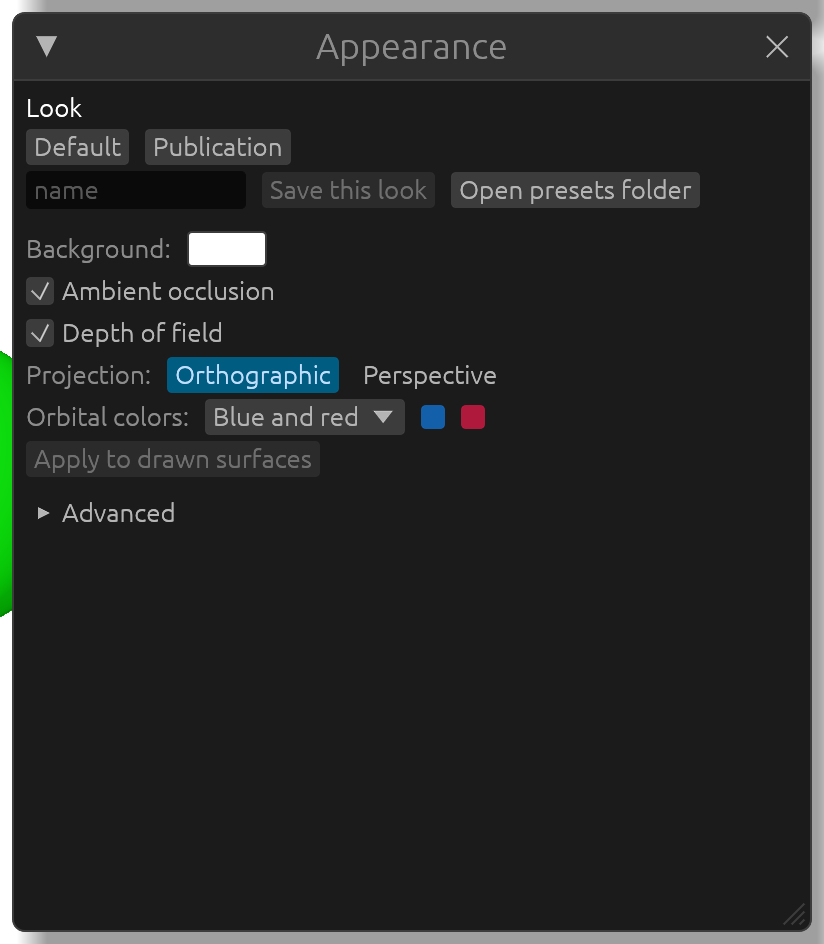

# Appearance

The **Appearance** window sets the look of the whole scene, shared by every open structure. It is what exported images and videos look like too.

- **Look**: **Default**, or **Publication**, with the light coming from the viewer's direction and no shiny highlights, so every part of the molecule is lit the same way whatever its orientation.
- **Background:** the background color (exported images can also have a transparent background, see [Figures and videos](figures.md)).
- **Ambient occlusion**: soft contact shadows where atoms, bonds and surfaces meet, which give the picture depth. Exports compute it with many more samples than the live view.
- **Depth of field**: blurs what is far from the center of rotation, like a camera lens.
- **Projection**: **Orthographic** (the default) draws without perspective, as most figures in papers are made: equal bonds look equal anywhere in the picture, and two structures shown the same way compare at the same scale everywhere, not only at the center. **Perspective** makes nearer parts larger, as through a camera, which can help while turning a molecule by hand. Sessions remember the choice; a session saved before APOST3Dview 0.9.1 reopens in perspective, as it was made.
- **Orbital colors**: the colors of the positive and negative lobes of orbitals, cubes and the spin density drawn from now on: **Blue and red** (the default), **Blue and amber** (the blue of the Okabe-Ito palette, made for color-vision deficiency) or **Teal and amber**. Each pair was checked as the program draws it, after its lighting: the two lobes stay clearly apart, also under simulated protanopia, deuteranopia and tritanopia, and each lobe stays distinct from the atom colors of H, C, N, O, F, S, Cl, Fe and Br; the pairs were also compared opaque and translucent, with and without ambient occlusion, on white and dark backgrounds. **Apply to drawn surfaces** recolors the orbitals, cubes and spin densities already drawn; the total density keeps its light blue, and each surface's colors can still be changed in the **Surfaces** window. Sessions and your own looks remember the choice.
- **Advanced**: every fine-tuning slider. **Light** (its direction and the exposure), **Atoms and bonds** and **Surfaces** (ambient light, roughness, reflectance, light intensity; for surfaces also the rim), and, when they are on, **Ambient occlusion** and **Depth of field** (with a **Default** button each).

## Your own looks

Once you like a look, type a name and click **Save this look**. It appears as a button of its own next to **Default** and **Publication**, in every later session; its **×** deletes it. Each look is a small text file in your settings folder; **Open presets folder** shows it, to back looks up or give them to someone else:

| System | Folder |
|---|---|
| Windows | `%APPDATA%\APOST3Dview\data\presets` |
| macOS | `~/Library/Application Support/APOST3Dview/presets` |
| Linux | `~/.local/share/apost3dview/presets` |
