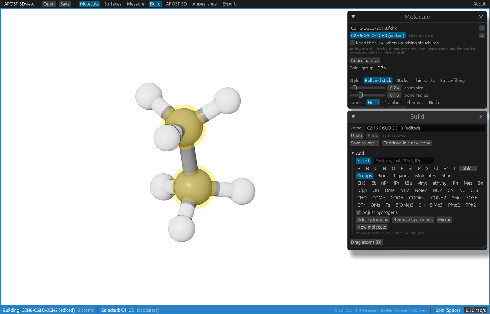
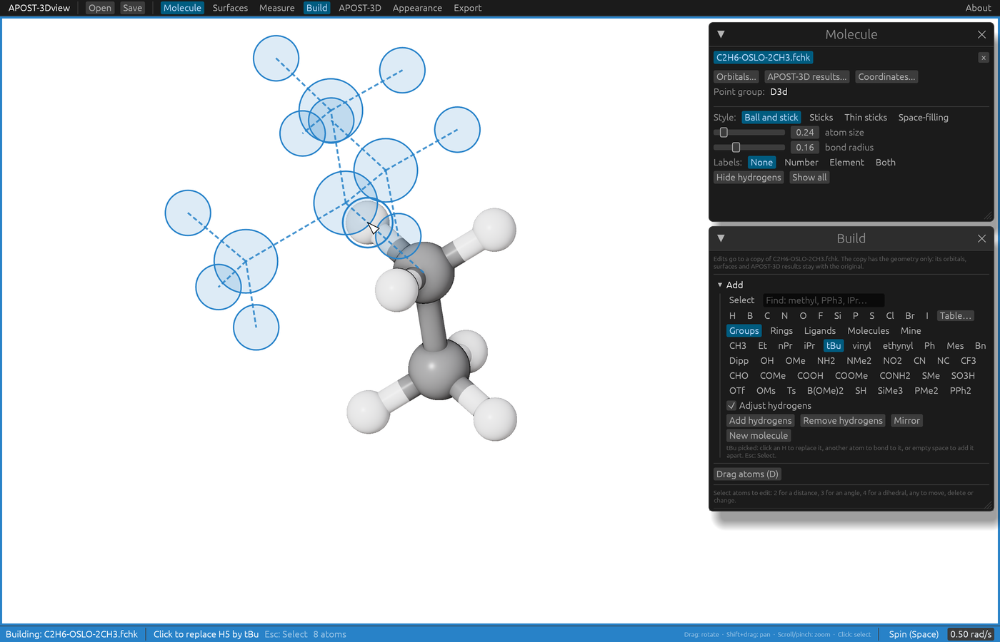
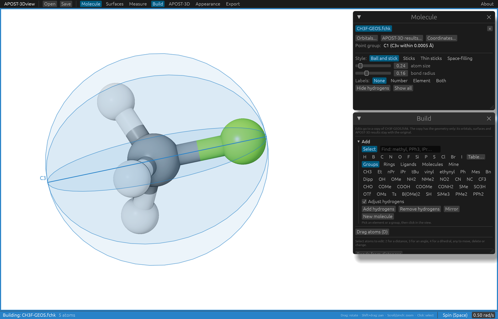

# Editing a molecule

The **Build** window builds and changes a geometry: add atoms, groups, ligands and molecules, set a distance, an angle or a dihedral, turn a group about a bond, move atoms, delete atoms, change an element. Edits never touch a file or the structure opened from it. The first edit makes a copy, and every edit can be undone.

**Build** is in the toolbar once **Building and editing molecules** is ticked. APOST-3Dview asks at the first start, and **Features...** in the About window changes it later.

## The Build mode

While the Build window is open, the view has a thin blue frame and the status bar is blue, starting with "Building:" and the name of the structure. Close the window (or click **Build** in the toolbar again) and the app is exactly as before.

Clicks select atoms as always, and the edits act on the selection, in the order the atoms were clicked. <kbd>Cmd</kbd>/<kbd>Ctrl</kbd>+<kbd>Z</kbd> undoes, <kbd>Cmd</kbd>/<kbd>Ctrl</kbd>+<kbd>Shift</kbd>+<kbd>Z</kbd> redoes, <kbd>Delete</kbd> deletes the selected atoms and <kbd>D</kbd> switches dragging atoms on or off. These keys work only while the Build window is open, and never while you type in a field. Every key and gesture of Build mode is also listed in [Mouse and keyboard](controls.md).

## Edits go to a copy

Nothing happens when the window opens. At the first edit, APOST-3Dview makes a copy of the structure shown, named after it with "(edited)", places it right under the original in the Molecule window's list and shows it. The original stays as it was. Later edits go to the same copy while it is the structure shown.

The copy takes the geometry, the bonds (including those made with **Create bond**), how they are drawn, hidden atoms and measurements. It doesn't take the wavefunction, orbitals, surfaces or APOST-3D results: those belong to the calculation, and stay with the original.

The copy's name is in the **Name:** field at the top of the window. **Continue in a new copy** keeps the copy as it is now and goes on in a new copy of it, so you can keep several stages side by side.

The frames of a path can't be edited. Open each frame as a structure (Molecule window) to edit one geometry.

## Adding atoms, groups and ligands

The **Add** section at the top of the Build window works like GaussView or Chemcraft: pick something, then click where it goes.

1. Pick an element (H, C, N, ... or any element in **Table…**) or a group from the tabs: **Groups** (CH3, tBu, Ph, Mes, Dipp, OMe, NMe2, NO2, CF3, COOMe, OTf, SiMe3, PPh2, ...), **Rings** (cyclohexyl, naphthyl, pyridyl, adamantyl, ...), **Ligands** (CO, NO, NH3, py, MeCN, PMe3, PPh3, PCy3, PtBu3, P(OMe)3, isocyanides, and the carbenes IMe, ItBu, IMes, IPr, SIMes, SIPr and cAAC), **Molecules** (water, benzene, solvents, ...) and **Mine** (your own groups). Or type part of a name in the find field (<kbd>Cmd</kbd>/<kbd>Ctrl</kbd>+<kbd>F</kbd>): "carbene", "phosphine", "Dipp". Hover over a button for its full name and where its coordinates come from.
2. Move the pointer over the molecule. Before you click, the view shows in blue outlines where the new atoms would go, the atom under the pointer is ringed, and the status bar says exactly what a click will do, for example "Click to replace H5 by tBu".
3. Click. It is one edit (made in the copy, undone with <kbd>Cmd</kbd>/<kbd>Ctrl</kbd>+<kbd>Z</kbd>), and the new atoms are left selected, so **Turn about**, dragging or <kbd>C</kbd> act on them right away.

What is picked stays picked, so several clicks add several groups. <kbd>Esc</kbd> or **Select** gives clicks back their usual meaning (a second <kbd>Esc</kbd> clears the selection).

What a click does depends on where:

- On a hydrogen: the group takes its place, bonded to the same atom along the same direction. An element brings its own hydrogens: C gives CH3, N gives NH2, O gives OH.
- On another atom: the group bonds to it on its free direction, the empty corner left by its neighbours and lone pairs (a tetrahedron, a triangle or a line, as the atom's valence asks; at a metal, the site its other ligands leave). An element changes the atom instead; with **Adjust hydrogens** ticked (the default) its hydrogens are added or removed to fit (C to N on a CH3 gives NH2, a ring C to N in benzene gives pyridine). H on an atom adds one hydrogen.
- In empty space: the group goes there as a separate piece, on the plane through the middle of the view. A group's open bond gets a hydrogen (tBu gives isobutane); a ligand or a molecule goes as it is.

The new bond has the typical length for its two atoms (the same table **Clean (C)** uses), and the group is turned about it to where it has the most room, which also makes it staggered. Nothing else moves: <kbd>C</kbd> tidies everything when you want it.

A ligand takes one site of a metal. Ligands that bind through several atoms (chelates, pincers, η5 rings) are not offered yet.

**Add hydrogens** gives the selected atoms (all atoms when none is selected) the hydrogens their usual valence asks for, and **Remove hydrogens** removes theirs. **Mirror** makes the mirror image, reflected left to right as seen: the other enantiomer. **New molecule** starts a new structure, without a file, from what is picked (methane with **Select**), so you can build from nothing; it is written into sessions like an unsaved copy.

### Your own groups

Select the atoms of a group in any structure, for example a ligand from a calculation. Exactly one bond must leave the selection: it says where the group bonds. Under **Mine**, type a name, tick **Ligand** if it should be listed with the ligands, and click **Save selection as a group**. It is saved as an .xyz file in the settings folder (**Open groups folder** shows it: copy the files to share them) and appears under **Mine**, with × to delete it.

### Where the groups come from

The common groups, rings and ligands are from Avogadro's fragment collection (BSD licence, which comes with the program as Avogadro-fragments-LICENSE.txt), the molecules and some ligands are PubChem 3D conformers, and the cAAC and Dipp are from a DFT structure (Chem. Sci. 2022, 13, 6583). The NHCs and a few groups are put together from those by the builder itself and tidied with Clean. A test checks every one: in one piece, no atoms too close, Clean changes its bond lengths by less than 0.2 Å, and placed it makes only the bond it should.

## Setting a distance, an angle or a dihedral

Select 2 atoms for a distance, 3 for an angle (the second is the vertex) or 4 for a dihedral. The value appears in a field. Type the new one and press <kbd>Enter</kbd> or **Set**. Distances are in the unit of Measure (Å or bohr), angles and dihedrals in degrees. Dihedrals have the IUPAC sign, as in Gaussian or ORCA: positive when, looking from the second atom to the third, the first bond turns clockwise to cover the last.

**Moves:** says what moves:

- **C2 and its side** (with C2 the last atom clicked, the default): the last atom and everything still connected to it once its bond is cut. For a dihedral, the bond cut is the middle one, so the whole group behind the third atom turns, every atom of it.
- **C2 alone**: the last atom only.
- **Both sides, half each**: each end with its side, by half the change.

The sides follow the bonds drawn. When the atoms are in one ring the sides can't move apart, and only the last atom moves (the window says so). To move a piece that the bonds join to the rest, hide the bond that joins it (Molecule window): it is cut there. To move two pieces together, join them with **Create bond**.

With 2 atoms selected, **Turn** turns the second atom's side about their bond by the angle typed, in degrees.

## Moving, deleting and changing atoms

- **Move**: moves the selected atoms by the x, y and z typed (empty means 0), along the molecule's own axes.
- **Delete selected atoms**: deletes them and their bonds. Measurements that used them go too.
- **Element:** turns the selected atoms into the element clicked, or the one typed in **Other element:** and **Change**. Only the element changes: the hydrogens stay as they were.

After an edit the bonds stay as they were, so a stretched bond stays drawn. **Bonds from distances** works them out again from the distances, as when a file is opened.

## Dragging atoms

**Drag atoms (D)** (or the <kbd>D</kbd> key) lets you move atoms with the mouse. It is off whenever the Build window opens, so a drag only moves atoms when you switched it on, and closing the Build window switches it off.

While it is on:

- A drag from an atom moves it in the plane of the screen, following the pointer exactly.
- <kbd>Cmd</kbd>+drag (<kbd>Ctrl</kbd>+drag on Windows and Linux) from an atom turns what moves about its center: left and right about the screen's vertical, up and down about its horizontal.
- <kbd>Shift</kbd>+drag up or down from an atom moves it toward you or away (down brings it closer), the one direction a plain drag can't.
- A drag from empty space still rotates the view, and <kbd>Alt</kbd>+drag still draws a selection box. Clicks still select.
- <kbd>Esc</kbd> before releasing puts everything back where the drag started.

**Drag moves:** chooses what moves:

- **The atom (or the selection)**: the atom grabbed, or every selected atom when the one grabbed is selected. Select a group first, then grab any of its atoms.
- **Its piece**: everything bonded to the atom grabbed, directly or through other atoms, such as a whole ligand or a solvent molecule. Pieces follow the bonds drawn: hide a bond to cut a piece off.

Each drag is one edit: the first one makes the copy, and **Undo** takes a whole drag back. While you drag, the status bar says how far the atoms moved or how much they turned, and measurement labels follow the atoms, so you can drag a distance close to what you want by eye and then **Set** it exactly. Over an atom, the pointer becomes a hand.

## Clean and Rebuild

**Clean (C)** tidies the geometry from where it is: bond lengths typical for the two elements and the kind of bond (single, aromatic, double or triple, read from how long the bond is now), angles from the atom's electron domains (VSEPR: 180° for two, 120° for three, 109.5° for four, a little less with lone pairs, so water is bent and ammonia pyramidal), flat aromatic and sp2 centres, staggered single bonds, and no atoms on top of each other. It takes milliseconds, and it is a starting geometry for a calculation, not an optimization: the lengths and angles are typical values, not this molecule's.

- **Keep the symmetry** (on): the point group the structure has to within 0.01 Å stays exact.
- **Hold the selected atoms**: they don't move, and the rest adapts around them.
- **Metals:** **Keep as they are** (the default) leaves bond lengths and angles at metals alone, since simple rules describe them poorly. **Ideal** takes metal-ligand lengths from covalent radii and snaps the angles at a metal to the nearest ideal polyhedron (octahedral, tetrahedral, square planar, trigonal bipyramidal), for badly drawn complexes.
- Under **Advanced**, **Prefer staggered single bonds** can be switched off, to keep a conformation you set on purpose.

**Rebuild (Shift+C)** is for drawings too poor for Clean: everything flat, atoms on top of each other, a ring folded through itself. It builds the structure again from its bonds alone (which atoms are bonded to which) and the handedness of any stereocentre the drawing shows, then cleans it. The coordinates themselves hardly matter, so the bonds must be right: look at them before rebuilding, and fix a missing or extra one with **Create bond** or by hiding it (Molecule window). The result is one sensible conformation, not necessarily the one you meant, and it is placed where the drawing was.

Both are one edit each, so **Undo** takes them back.

## Symmetry

The Molecule window shows every structure's point group on the **Point group:** line, also without the Build window. It is the group a quantum chemistry program would find: atoms where the symmetry puts them to within 0.0001 Å, about as tight as Gaussian, ORCA (10⁻⁴ bohr) and Q-Chem (10⁻⁵). A geometry optimized without symmetry is rarely that exact, so when the structure is close to a higher group the line names it too, with how far the atoms are from it: "C1 (C3v within 0.0005 Å)".

The **Symmetry** part of the Build window lists the groups the structure is close to, each with the largest move an atom would make to have it exactly. Point at one, or click it to choose it, and its symmetry elements are drawn in the view: rotation axes as lines through the center (labeled C2, C3, ...), mirror planes as faint discs, the inversion center as a dot. A group can appear more than once when it can be reached in different ways (two different mirror planes, for example), each with its own move, and the drawing tells them apart.

- **Symmetrize to** (the group chosen) moves the atoms so the group is exact, to about 10⁻⁶ Å, so a program finds it. The center and the orientation stay as they are. Like every edit it goes to the copy and can be undone, and the status bar says how far the atoms moved.
- **Standard orientation** turns and moves the coordinates as Gaussian orients a molecule: the center of nuclear charge at the origin and the main axis of the structure's symmetry (the highest group within 0.01 Å) along z, with x along a perpendicular C2 axis or in a mirror plane. The view turns with the molecule, so the picture doesn't change. It is never done on its own: only this button moves the coordinates that way.

The point groups are checked against pymatgen on 29 structures, from water to C60 and from ideal geometries to real calculations ([File formats and what is validated](formats.md)).

## Undo and saving

**Undo** and **Redo** go back and forth through the copy's edits, up to 200 of them, while the program runs.

**Save as .xyz...** writes the copy's coordinates, offering its name as the file name, so rename it first to get the file name you want. The comment line of the file says which file it was made from. After saving, the copy refers to that file, and its note in the Molecule window says "edited, saved".

A session keeps edited copies. A copy saved as a file is kept like any file. A copy not saved yet is written into the session itself, and such a session needs this version of APOST-3Dview or a later one (an older one says so instead of opening it). Closing an unsaved copy asks nothing, and undo can't bring it back, so save the ones you want to keep.
