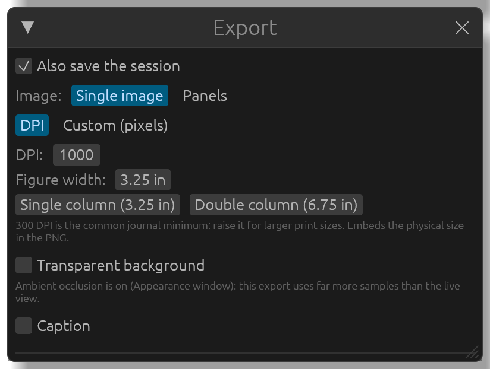
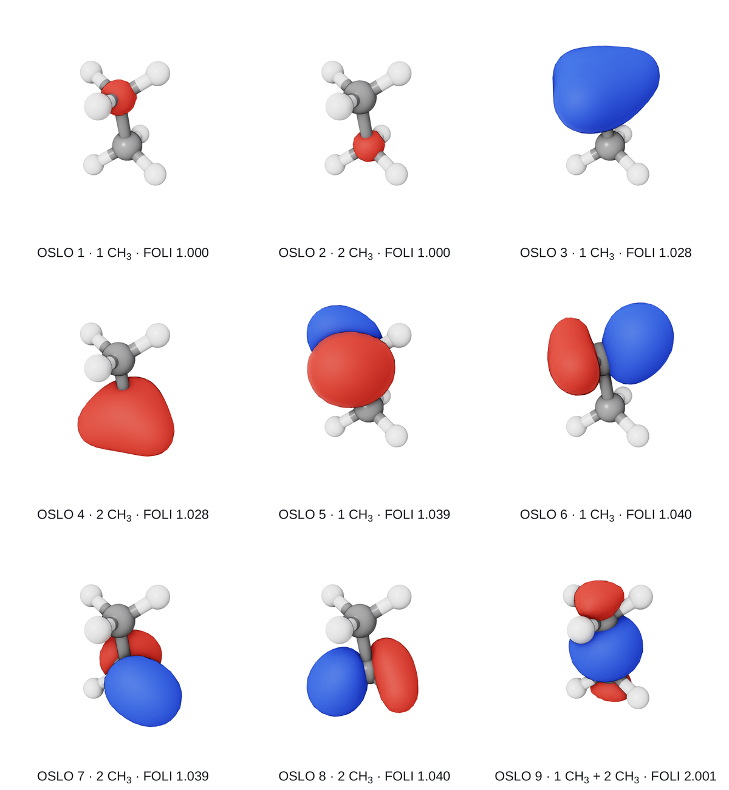
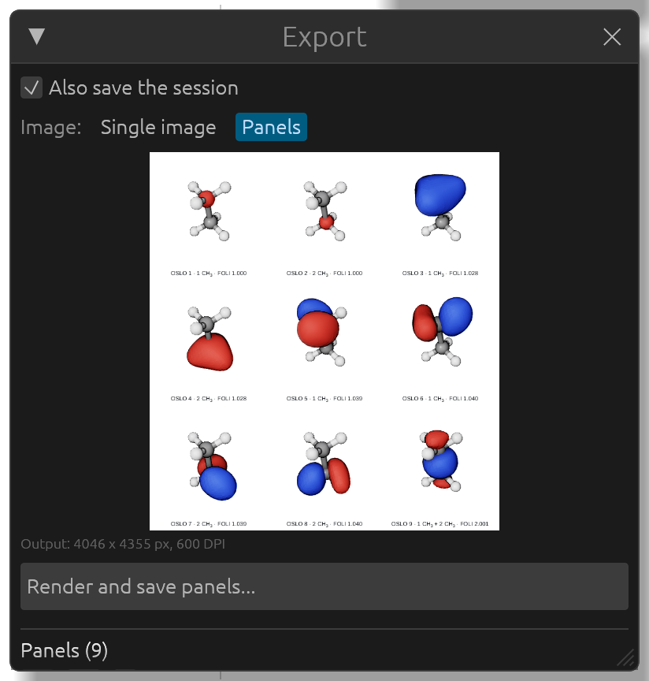

# Figures and videos

The **Export** window saves the current view, exactly as it is on screen (labels, values, legend, ambient occlusion and depth of field included), as a PNG image, as a figure of several panels with captions, or as a looping animated GIF.

## Images

With **Single image** chosen next to **Image:** (the default):

- **DPI** (the default): give the resolution and the **Figure width:** in inches, or click **Single column (3.25 in)** or **Double column (6.75 in)**; the height follows the shape of the view. The physical size is stored in the PNG, so the figure comes in at the right size in a document. 300 DPI is the usual journal minimum.
- **Custom (pixels)**: give the **Width:** and **Height:** in pixels, and a **Supersample:** factor (rendering at 2 or 4 times the size and scaling down smooths every edge).
- **Transparent background**: no background, for putting the molecule on a slide or over another picture.
- **Caption**: a caption below the image. Leave the field empty for the automatic one (the name of the surface shown, as in the panels below), or type your own; **Text size:** sets its size in points.

The window shows the size of the image that will be made. Click **Render and save PNG...** and choose where to save it.

## Panels: several orbitals in one figure

Most figures of bonding analyses are grids of orbitals, all seen the same way, each with a caption: the OSLOs of a molecule with their FOLI, the effective fragment orbitals of a metal with their occupations. **Panels** makes such a figure in one step. Every panel is the current view with one surface shown alone, rendered exactly as a single image would be, so all the panels share the same orientation, zoom and look.

1. Generate the orbitals you want (see [Orbitals and densities](orbitals.md)), turn and zoom the molecule as it should look in every panel.
2. In **Export**, choose **Panels** next to **Image:**. Every surface of the structure becomes a panel, in the order of the **Surfaces** list. While **Panels** is chosen, a dashed frame in the view shows what a square panel holds.

3. The list under **Panels** sets the order (the arrows move a panel up or down, the cross removes it). **Add a panel** adds a surface again, or the structure as it is shown, and **All surfaces** adds every surface not in a panel yet.
4. Each panel has a caption field. Left empty, it shows the automatic caption (in gray); type to give that panel your own text. With **Captions** ticked, the automatic caption is either **Full**, the name with its number ("OSLO 9 · 1 CH3 + 2 CH3 · FOLI 2.001", "EFO 10 α · 1 Fe · occ. 0.890"), or **Value and fragment**, the number with the fragments as papers often write it ("2.001 (CH3 + CH3)", "0.890 (Fe)"). Digits in chemical formulas are drawn as subscripts (CH₃), and an EFO the orbital file reproduces poorly says so ("fit 48%"). **Text size:** is in points; **Letters (a), (b), ...** adds a letter at the top left of every panel.
5. **Layout:** is **Automatic** (about as many rows as columns: 3 x 3 for nine panels, 2 x 3 for five, the last row centered) or **Rows and columns**, set by hand; **Swap** turns a figure that runs across into one that runs down, or the reverse. **Panel shape:** is **Square** or **As the view**, and **Gap:** the space between panels, in percent of a panel's width.
6. **Size:** is **DPI** (the resolution, 600 by default, and the **Figure width:**, the whole figure; **Half page (3.25 in)** and **Full page (6.75 in)** are the widths of one column and of a whole page in a two-column journal) or **Pixels** (the **Panel width:** of each panel). The text size in points follows the DPI.
7. **Background:** is **White** (the default, whatever the view's background), **As the view**, or **Transparent**.

The preview at the top of the window shows the figure as it will be saved, and follows every change: rotate the molecule, edit a caption, change the layout, and it is drawn again a moment later. Click it to see it larger in **Figure preview**. Then click **Render and save panels...** and choose where to save it. A large figure takes a few seconds: every panel is rendered at full size with ambient occlusion.

When a value of the APOST-3D results is shown on the molecule, its legend is drawn once below the panels if it is the same in all of them, and in each panel otherwise.

### Panels of several structures

**Add a panel** also offers the other open structures, with their surfaces or as they are shown, to put related molecules side by side. Each structure is seen with its own view, the one it had when you last left it: make it the active one in the **Molecule** window to turn or zoom it. To see them all the same way, tick **Keep the view when switching structures** in the **Molecule** window: every structure then has the orientation and zoom of the active one, each centered on itself, so molecules of the same family compare at the same scale. The same orientation shows the molecules alike only when their coordinates are oriented alike in their files.

## Turning videos (GIF)

Under **Animation (GIF)**, give the **Width:** in pixels, the **Duration:** of one full turn, and the **Frame rate:**, then click **Render and save GIF...**. The molecule makes one full turn from the current view and the video loops seamlessly. It turns in the direction of the last arrow key pressed (horizontally if none was), about the center of the view, so leave some margin around the molecule. GIF files play directly in PowerPoint, Keynote and Google Slides. They use the background color of the **Appearance** window.

## The session beside each figure

With **Also save the session** ticked (the default), every export also writes a session next to the image: `figure.a3dview` next to `figure.png`. Opening it later gives back exactly the same picture, to change it or make it again at another size; for a figure of panels, it keeps the panels, their captions and the layout too. See [Sessions](sessions.md).
