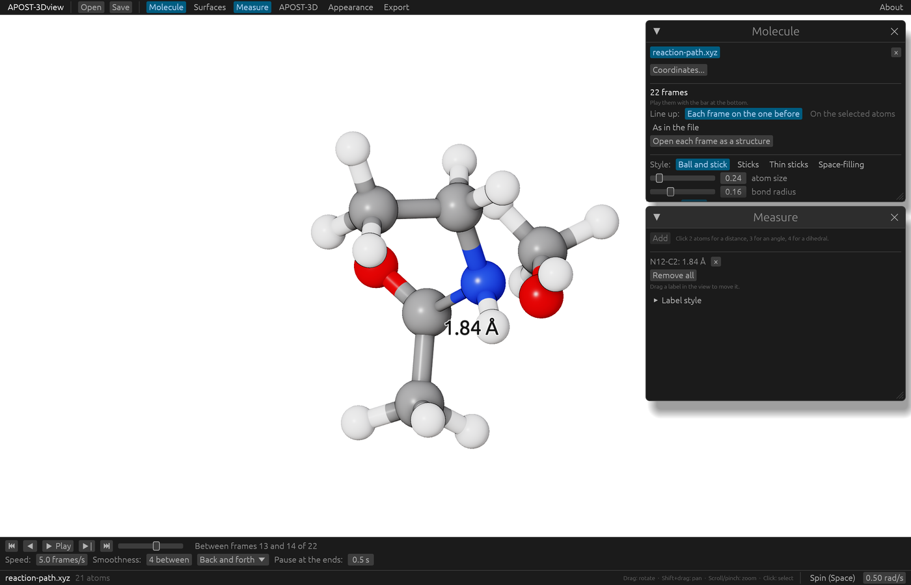

# Reaction paths and other frames

An `.xyz` file can hold several geometries one after the other: the points of an IRC, the images of a NEB, the steps of an optimization. APOST-3Dview recognizes such a file when it opens it. When every geometry has the same atoms in the same order, the file opens as **one structure with frames**, shown one at a time. When the geometries are different molecules, each opens as a structure of its own, named after the file with its number, for example `two.xyz (2)`.

The example `examples/reaction-path/reaction-path.xyz` is a path of 22 frames: ethylamine adding to methyl acetate, the nitrogen bonding to the carbonyl carbon while its hydrogen moves to the methoxy oxygen, giving N-ethylacetamide and methanol. Open it to follow this page.

## Going through the frames

While the structure shown has frames, a bar along the bottom of the window plays them. Its buttons go to the first frame, the previous one, play or pause (**▶ Play**), the next frame and the last one. The slider goes to any frame, and the text beside it says where you are ("Frame 12 of 22"). <kbd>,</kbd> and <kbd>.</kbd> step one frame back and on.

Everything you set on the structure stays as the frames change: hidden atoms, labels, the style, the selection and measurements. A measurement shows its value in the frame shown, so measuring the bond that forms (select the two atoms, **Add measurement**) lets you watch it shrink along the path.

Bonds are worked out from the distances in each frame. A bond that forms grows in, and a bond that breaks thins out, over a short range of distances just beyond the usual bonding distance, rather than appearing or vanishing at once. Near a transition state an atom on the move can be far enough from both partners that neither bond is drawn. Bonds you hide or draw dashed (**Dashed (TS)**) keep that in every frame, and a bond you create with **Create bond** is drawn in every frame.

## Playing them

**▶ Play** plays the frames in the window. While they play you can rotate, zoom, change the style or the look, and turn the molecule with **Spin (Space)** as well. Under the buttons:

- **Speed:** frames of the file per second.
- **Smoothness:** how many geometries are drawn between two frames of the file, on a smooth curve through the frames. 0 jumps from frame to frame. Higher values make the motion smoother, which helps most for paths with few frames, such as a NEB.
- the loop: **Back and forth** (first to last and back, the natural one for a reaction), **Repeat** (first to last, again and again) or **Once**.
- **Pause at the ends:** how long the first and the last frame stay before the motion starts again.

## Energies along the path

When the comment line of every frame gives an energy, the bar also plots it: the energy of each frame relative to the first, in kcal/mol, with a line where you are. Click or drag on the plot to go to a frame, and hover a point to read its value. The energies are read the way programs write them on that line: ORCA's `... E -76.4`, xtb's `energy: -5.07 ...`, a line that holds only a number (all in hartree), or the `energy=` of an extended xyz file (electronvolt, as ASE writes it). The example has no energies.

## Lining up the frames

Programs often write each geometry in its own orientation, so the molecule would tumble from frame to frame. Under **Line up:** in the **Molecule** window:

- **Each frame on the one before** (the default): every frame is turned and moved onto the one before it, using all atoms, so only the real motion is left.
- **On the selected atoms**: select three or more atoms first (a catalyst, a metal and its ligands, the part that doesn't react) to keep those still and see the rest move.
- **As in the file**: the coordinates as written.

Lining up only turns and moves whole frames. Distances, angles and bonds are the same in every choice.

## Frames as structures of their own

**Open each frame as a structure** adds one structure per frame, as lined up. Use it to look at two frames side by side, to [align](molecule.md#aligning-related-molecules) them, or to make [panels](figures.md#panels-of-several-structures) of the reactant, transition state and product.

## A video of the path

In the **Export** window, a structure with frames offers **Animate:** **Play the frames** or **Turn**. With **Play the frames**, **Render and save GIF...** records the frames exactly as they play in the window: the same speed, smoothness, loop and pauses, from the current view. If **Spin (Space)** is on, the molecule turns in the GIF as well. A GIF plays at most 50 pictures per second, so very high speeds with high smoothness are refused: lower one of them.

## Sessions

A session records where the frames were, how they are lined up and how they play, and reopens them that way. Frames opened as structures of their own come back as such.
