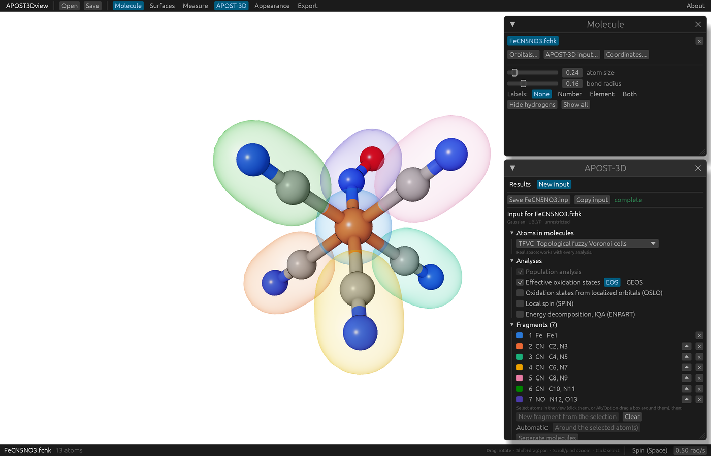
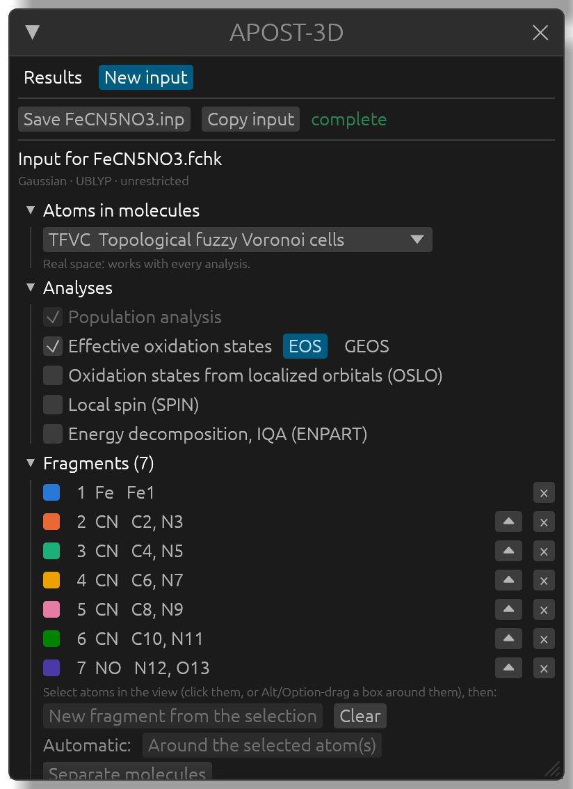

# Making an APOST-3D input

For a `.fchk`, APOST3Dview prepares the input APOST-3D needs (`<job>.inp`) from a few choices: the atomic definition, the analyses, and the fragments, which are drawn on the molecule while you make them. It covers the common analyses with APOST-3D's defaults, and writes only what differs from them. For anything else (cube files, grids, thresholds, other analyses), edit the input by hand following [APOST-3D's input reference](https://github.com/mgimferrer/APOST3D).

## Opening the form

Open the calculation's `.fchk`. If there are no APOST-3D results next to it, the **Molecule** window shows **APOST-3D input...**, which opens the **New input** tab of the **APOST-3D** window. The tab is always there, next to **Results**.

The form starts with the file's name and what APOST3Dview read from it (the program, the method, and whether the wavefunction is restricted, unrestricted or correlated).

## Atomic definition and analyses

- **Atoms in molecules**: the atomic definition. *TFVC* (topological fuzzy Voronoi cells, real space) is recommended and works with every analysis; *Mulliken* and *Lowdin* (Hilbert space) are fast but depend on the basis set, and can't be used for GEOS, OSLO or the energy decomposition. Other definitions are offered when their files are there (a `.nao` file for NAO-BASIS, a `densoutput` folder for Hirshfeld).
- **Analyses**: **Population analysis** is always done (charges, bond orders, valences). Then **Effective oxidation states**, with **EOS** or **GEOS** (GEOS needs a real-space definition), **Oxidation states from localized orbitals (OSLO)** (for HF and DFT only), **Local spin (SPIN)** and **Energy decomposition, IQA (ENPART)**. A choice that can't be used with the rest is grayed out, and hovering over it says why.

For a correlated wavefunction written by APOST-3D's `apost3d.py` script (CASSCF, FCI, CISD, CCSD from PySCF), the input asks for its density matrices (the `.dm1` and `.dm2` files next to the `.fchk`), which also gives the local spin analysis: **Local spin (SPIN)** is then ticked and grayed out.

For the energy decomposition, the section **Energy decomposition (ENPART)** chooses the **Functional** of the calculation: it is taken from the `.fchk` when the file names it (Gaussian files); otherwise choose it from the menu. Meta-GGA and range-separated functionals aren't supported by APOST-3D's decomposition. **Two-electron grid** is APOST-3D's **Standard (150 × 590)** grid, or a **Faster (40 × 146)** one, much cheaper and less accurate, for tests.

## Fragments

EOS, GEOS and OSLO need fragments; the other analyses can use them to group their results. The fragments are drawn on the molecule as envelopes in their colors while the tab is shown, and atoms in no fragment in gray.

- By hand: select atoms in the view (click them, or <kbd>Alt</kbd>+drag a box around them, <kbd>Option</kbd>+drag on a Mac), then click **New fragment from the 3 selected** (the button counts them). Atoms already in another fragment move to the new one.
- Around a metal: select the central atom (or atoms) and click **Around the selected atom(s)**: each selected atom becomes a fragment, and each ligand left when they are taken out becomes another. Ligands bound through several atoms stay whole, and an atom bridging two centers becomes a fragment of its own.
- One per molecule: **Separate molecules** makes one fragment of each set of bonded atoms, for a dimer or a cluster.

The automatic fragments follow the bonds drawn. If one is wrong, fix the bond in the **Molecule** window (**Create bond**, **Hide bond**) and click again.

In the list, **×** removes a fragment, the arrow moves it up (fragments are numbered in list order), clicking one selects its atoms, and **Clear** removes them all.

## Problems, notes and saving

What would stop APOST-3D is listed at the top in red (for example, fragments missing for EOS, or atoms in no fragment), and saving waits until there are none; **complete** appears when the input is ready. Notes in orange point out things to know, such as files of a correlated wavefunction that are missing.

- **Save FeCN5NO3.inp** writes the input next to the `.fchk`, with the name APOST-3D looks for.
- **Copy input** puts it on the clipboard instead.
- **Input file**, at the bottom, shows the input as it is built, and the command to run it.

When `<job>.inp` already exists, the form starts from it. If it sets things the form doesn't handle, they are named, and saving from the form leaves them out. **Replace** then overwrites the input, and **Save as another job...** keeps it and saves the new input under another **Job name**, for another analysis of the same calculation. APOST-3D needs an input and a `.fchk` of the same name, so the `.fchk` is added under the new name too, as a link to the original that takes no extra disk space (a full copy where links aren't possible, as on a USB stick formatted FAT, and once the folder is copied to another computer or a cluster).

## Running APOST-3D

Run APOST-3D as usual in the folder of the input:

    apost3d <job> > <job>.apost 2>&1

and open the `<job>.apost.json` it writes ([APOST-3D results on the molecule](results.md)). Running APOST-3D from APOST3Dview isn't possible for now, since most runs go to a cluster.
