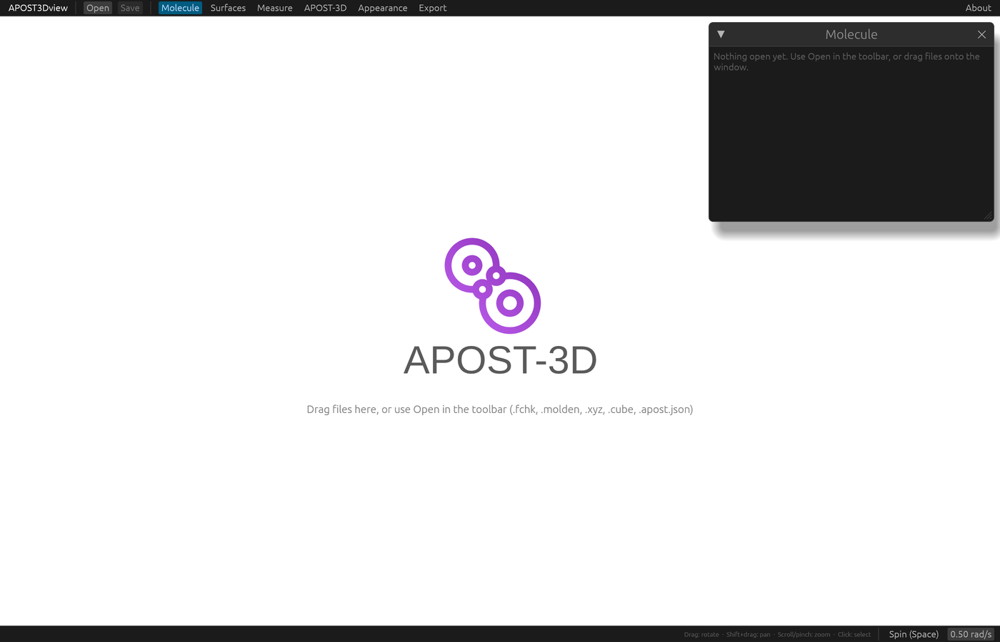
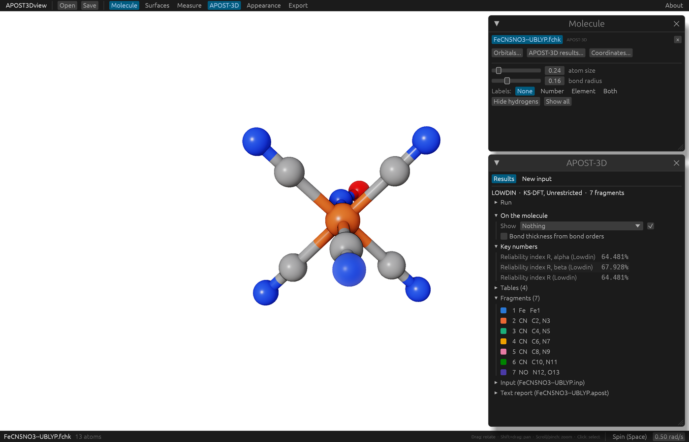

# Install and first start

APOST3Dview is free, and nothing else needs to be installed. Download the file for your computer:

| Your computer | Download |
|---|---|
| Windows 10 or 11 | [APOST3Dview-windows.zip](https://github.com/mgimferrer/APOST3Dview/releases/latest/download/APOST3Dview-windows.zip) |
| macOS 11 or later (Apple Silicon and Intel) | [APOST3Dview-macos.dmg](https://github.com/mgimferrer/APOST3Dview/releases/latest/download/APOST3Dview-macos.dmg) |
| Linux (x86_64) | [APOST3Dview-linux.tar.gz](https://github.com/mgimferrer/APOST3Dview/releases/latest/download/APOST3Dview-linux.tar.gz) |

Earlier versions are on the [releases page](https://github.com/mgimferrer/APOST3Dview/releases). Each download also holds an `examples` folder with five complete APOST-3D calculations, used in [the tour](tour.md), and this guide, to read without an internet connection (open `guide/index.html`).

The first time you open it, Windows and macOS ask once whether to trust it. That's because APOST3Dview isn't signed with a paid certificate, not because anything is wrong. What to click is below.

## Windows

1. Right-click the downloaded `APOST3Dview-windows.zip` and choose *Extract All*.
2. Open the extracted folder and double-click `APOST3Dview.exe`.
3. The first time only, Windows shows "Windows protected your PC". Click *More info*, then *Run anyway*.

## macOS

1. Open the downloaded `APOST3Dview-macos.dmg` and drag APOST3Dview onto Applications. Drag the `examples` folder somewhere of yours too (Documents, say) to keep it.
2. Open APOST3Dview from Applications. The first time only, macOS says it could not verify the app: click *Done* (not *Move to Trash*).
3. Open *System Settings*, then *Privacy & Security*. Scroll down to the message about APOST3Dview, click *Open Anyway* and confirm. From then on it opens like any other app.

## Linux

1. Unpack the download: `tar xzf APOST3Dview-linux.tar.gz`.
2. In the unpacked folder, run `./install.sh` to add APOST3Dview to your applications menu (for your user only, no root needed), or start `./apost3dview` directly.
3. A Vulkan driver for your graphics card is needed (Mesa's `mesa-vulkan-drivers`, or your card maker's driver). Most desktops have one already.

If it doesn't start, see [Troubleshooting](troubleshooting.md).

## The window

APOST3Dview opens on an empty window:

Open files with **Open** in the toolbar, with <kbd>Cmd</kbd>+<kbd>O</kbd> (<kbd>Ctrl</kbd>+<kbd>O</kbd> on Windows and Linux), or by dragging them onto the window. Every supported file is recognized by its name: `.fchk`, `.molden`, `.xyz`, `.cube`, APOST-3D's `.apost.json` and APOST3Dview's own sessions (`.a3dview`). Several files can be opened at once. The **Open** menu can also show one kind of file at a time, for example only "Gaussian checkpoint (.fchk)" files. From a terminal, `apost3dview file1 file2 ...` opens the files named.

With a file open, the window looks like this:

- The toolbar, at the top: **Open** and **Save** (sessions, see [Sessions](sessions.md)), then one button per tool window: **Molecule**, **Surfaces**, **Measure**, **APOST-3D**, **Appearance** and **Export**. A button opens its window, or closes it when it is already open. **About**, at the right, has the version, how to cite APOST3Dview and how to report a problem.
- The tool windows stack in a column at the top right, all the same width, so they never cover the middle of the molecule. Collapse one with its triangle and the ones below move up; resize one by dragging its border; drag one by its title to put it anywhere. **Arrange windows** appears in the toolbar when a window is out of the column, and puts them all back.
- The bar along the bottom names the structure shown and its number of atoms, the atoms selected (<kbd>Esc</kbd> clears the selection), how to move around, and **Spin (Space)**, which turns the molecule continuously (see [Mouse and keyboard](controls.md)).

The **Molecule** window lists every open structure; click a name to show it, or its **×** to close it. The rest of that window, and the others, are explained in the following chapters.
