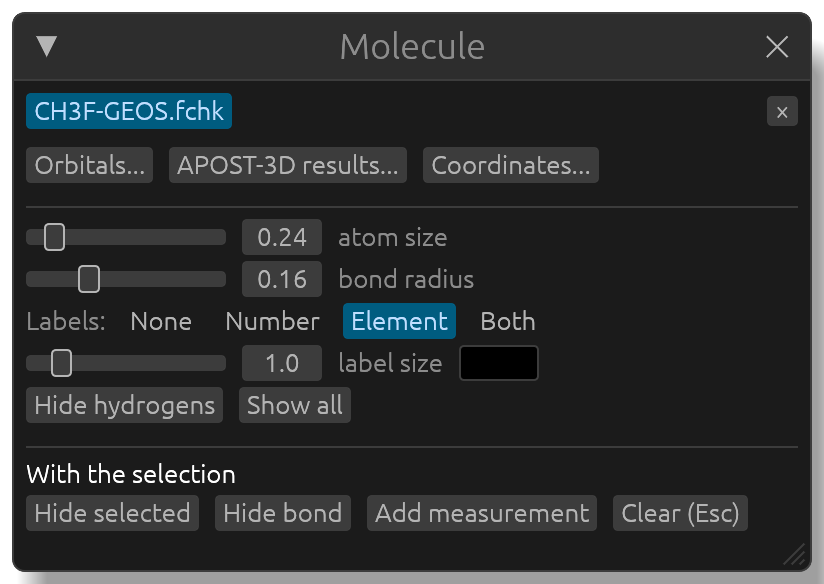
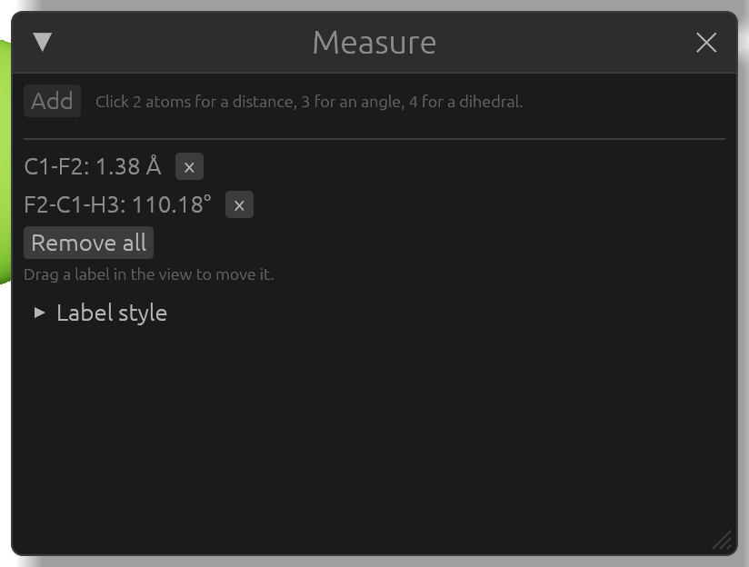
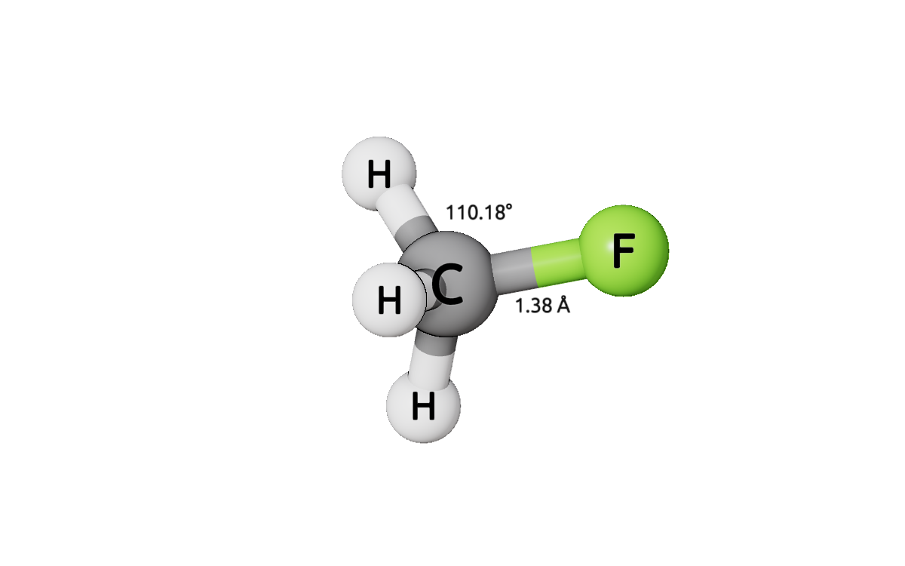

# Looking at a molecule

This chapter uses `CH3F-GEOS.fchk` from the `examples` folder (`examples/CH3F-GEOS`), but any `.fchk`, `.molden`, `.xyz` or `.cube` file works the same way.

## Moving around

- Rotate: drag with the mouse (either button) or the trackpad. The rotation is free in every direction, over the top too. The arrow keys rotate as well, two at once for a diagonal.
- Pan: <kbd>Shift</kbd>+drag.
- Zoom: scroll, or pinch on a trackpad.
- Spin: <kbd>Space</kbd>, or **Spin (Space)** in the bar along the bottom, turns the molecule continuously in the direction of the last arrow key pressed; the number next to it is the speed. Press <kbd>Space</kbd> again to stop.

Every control is listed in [Mouse and keyboard](controls.md).

## How the molecule is drawn

The **Molecule** window sets how the structure shown is drawn:

- **atom size** and **bond radius**: the sliders scale every atom and bond.
- **Labels:** **None**, **Number** (1), **Element** (C) or **Both** (C1). With labels on, a **label size** slider and a color button appear.
- **Hide hydrogens** hides every hydrogen atom; **Show all** shows every hidden atom and bond again, and makes all bonds solid.

Bonds are found from the distances between atoms. A bond that is missing, or one that shouldn't be there, can be fixed by hand (below).

## Selecting atoms and bonds

Click an atom to select it, and click more atoms to add them; click a selected atom again to take it out. A click on a bond selects the bond. To select many atoms at once, hold <kbd>Alt</kbd> (<kbd>Option</kbd> on a Mac) and drag a box around them. <kbd>Esc</kbd> clears the selection, and the bar along the bottom names what is selected.

While something is selected, the **Molecule** window shows what can be done with it, under **With the selection**:

- **Hide selected** hides the selected atoms and bonds.
- With two atoms selected: **Create bond** if they aren't bonded (for a contact too long to be found automatically), or **Hide bond** if they are.
- With two to four atoms selected: **Add measurement** (below).
- With bonds selected: **Solid**, or **Dashed (TS)** for a bond forming or breaking in a transition state.
- **Clear (Esc)** clears the selection.

## Measuring

Select two atoms for a distance, three for an angle, or four for a dihedral, in that order (the angle is at the second atom, the dihedral is about the bond between the second and the third). Then click **Add measurement** in the **Molecule** window, or **Add distance**, **Add angle** or **Add dihedral** in the **Measure** window.

Each measurement is drawn as a dashed line with its value beside the bond, or inside the angle, always readable over the molecule. Drag a label to move it. The **Measure** window lists the measurements (**×** removes one, **Remove all** every one), and **Label style** sets the font size, bold, the unit of distances (**Ångstrom** or **Bohr**), the decimal places and the colors.

## Coordinates

**Coordinates...** in the **Molecule** window opens the Cartesian coordinates of the structure, in Ångstrom or Bohr, as a table of atomic numbers (**Standard**) or element symbols (**Symbol XYZ**). **Copy** puts them on the clipboard. For a `.fchk`, **Save coordinates as CH3F-GEOS.xyz** writes them as an `.xyz` file next to it.

## Several structures

Open as many files as you like: the **Molecule** window lists them, and clicking a name shows that structure. Each structure keeps its own view: going back to one gives back the view it was left with, and a structure shown for the first time is framed. The view is kept as it is between two structures with the same geometry (two files of the same molecule). With **Keep the view when switching structures** ticked, the next structure is seen with the same orientation and zoom, centered on it: handy for comparing related molecules, or for [panels of several structures](figures.md#panels-of-several-structures). Hidden atoms, the selection and measurements belong to each structure; the look of the scene ([Appearance](appearance.md)) is shared by all.

### Aligning related molecules

Related molecules from separate calculations (two metals with the same ligands, two oxidation states) often come out of their programs turned differently, so the same view shows them differently. To show them the same way, align one onto the other on matching atoms:

1. In the first structure, select three or more atoms (click them one after the other; for a complex, the metal and a few ligand atoms).
2. Switch to the other structure and select the matching atoms, in the same order.
3. Click **Align onto** followed by the first structure's name in the **Molecule** window.

The structure is now seen exactly as the other one (**Keep the view when switching structures** is turned on): the matched atoms lie on the same spots, lit the same way, and stay so as you turn either one. The window says how well the atoms matched (the RMSD, in Å). Nothing in the files changes: orbitals, densities and APOST-3D values stay where they were computed; only the view is turned. **Undo alignment** goes back to the structure's own coordinates. Sessions keep the alignment.
