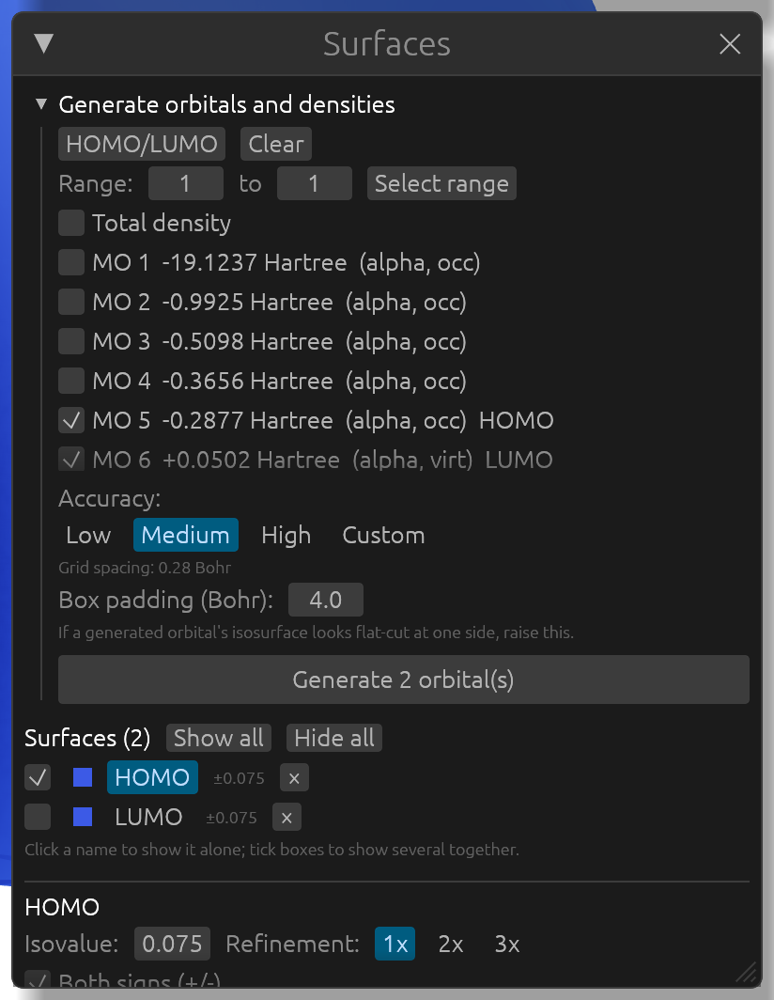
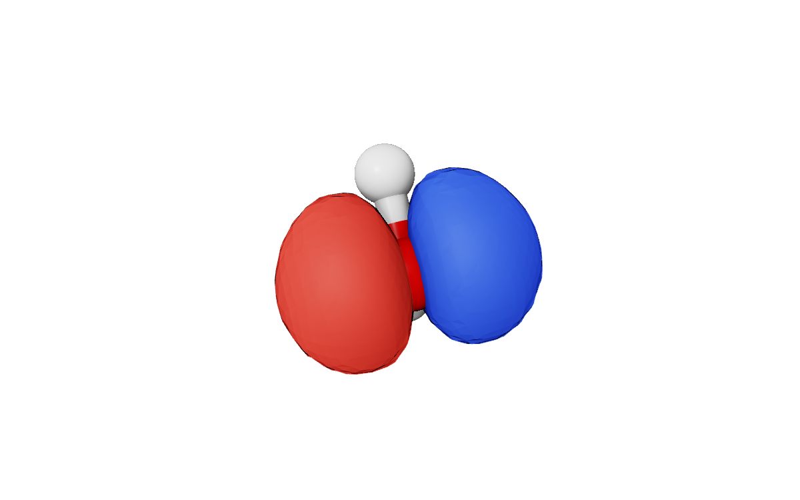
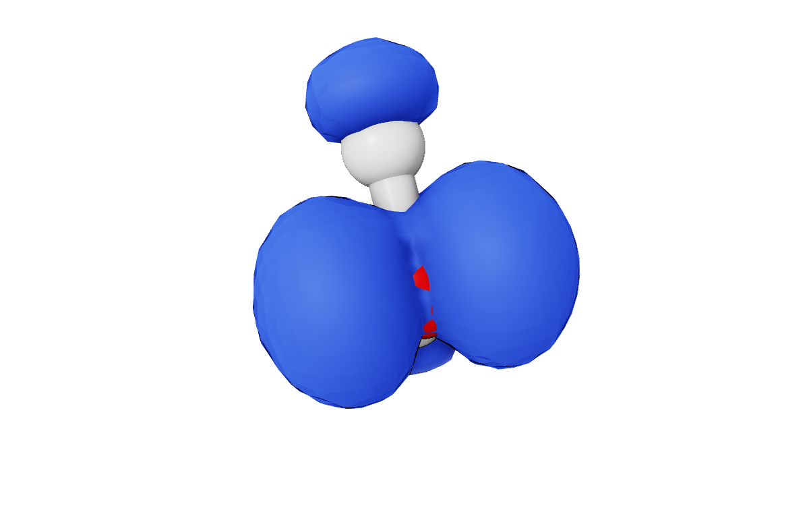
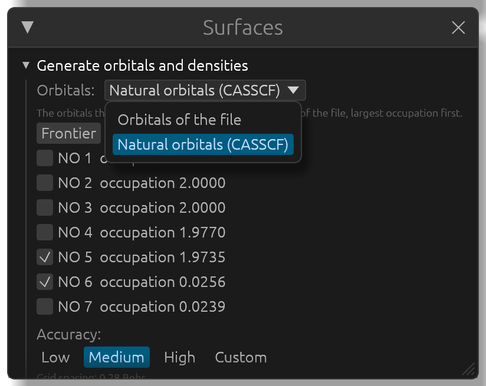

# Orbitals and densities

APOST3Dview draws molecular orbitals and densities straight from a `.fchk` (Gaussian, Q-Chem, PySCF) or `.molden` file (PySCF, ORCA): it evaluates the wavefunction on a grid itself, so no cube file has to be made first. It also shows `.cube` files written by any program. Everything drawn this way is a surface of the molecule, and all of them are listed together in the **Surfaces** window.

This chapter uses files from the `validation` folder of the [source repository](https://github.com/mgimferrer/APOST3Dview/tree/main/validation) and the H2O-CAS44 example.

## Generating orbitals

Open the `.fchk` or `.molden` file, then open the **Surfaces** window (or click **Orbitals...** in the **Molecule** window). Under **Generate orbitals and densities**, every molecular orbital is listed with its number, its energy in Hartree, its spin and whether it is occupied; the HOMO and LUMO are marked. For an unrestricted calculation there are two lists, alpha and beta.

1. Tick the orbitals you want. When a file opens, its HOMO is ticked. **HOMO/LUMO** ticks the HOMO and LUMO (of both spins, for an unrestricted calculation); **Range:** with **Select range** ticks a range of orbitals; **Clear** unticks everything.
2. Choose the grid: **Low**, **Medium** (the default, a grid spacing of 0.28 Bohr, close to Chemcraft's) or **High**, or **Custom** with a spacing of your own. **Box padding (Bohr)** is how far the grid reaches beyond the outermost atoms: if an orbital's surface looks cut flat on one side, raise it.
3. Click **Generate 2 orbital(s)** (the button counts what is ticked).

The orbitals are added to the list of surfaces, named "HOMO", "LUMO", "MO 12", or "MO 12 (beta)" for an unrestricted calculation. Generating an orbital again replaces it and keeps how it was drawn.

## Densities

Above the list of orbitals, tick **Total density**, and for an open-shell calculation also **Spin density** (alpha minus beta), then click the generate button. The total density starts translucent around the molecule, the spin density with both signs.

When the `.fchk` holds a correlated density matrix (Gaussian's MP2, CI or CC density, or the CASSCF, FCI, CISD or CCSD density written by APOST-3D's `apost3d.py` script for PySCF), the densities are those of the correlated wavefunction, evaluated through its natural orbitals. When the file holds both a mean-field and a correlated density, a **Density:** menu chooses between them (*SCF* or *MP2*, for example). The surface's name says which density it is: "Total density (MP2)".

## Natural orbitals

For a correlated density, the **Orbitals:** menu at the top of the **Surfaces** window also offers its natural orbitals, for example *Natural orbitals (CASSCF)*. They are listed by occupation, largest first, each with its occupation number. **Frontier** ticks the two either side of the gap (the last natural orbital with an occupation above 1 and the first below), **Fractional** ticks those between 0.02 and 1.98, **Clear** unticks them all.

In a file like this (a correlated density stored by `apost3d.py`), the file's own orbitals are listed as *Orbitals of the file*: they aren't SCF orbitals, and the file stores no orbital energies for them.

## Cube files

Open a `.cube` file like any other file. When a structure with the same geometry is already open (its `.fchk`, or other cubes of the molecule), the cube becomes one more surface of it; otherwise it opens as a new structure. Cube files in Bohr and in Ångstrom are both read.

## Showing and editing surfaces

Below the generation part, the **Surfaces** window lists every surface of the structure, with its isovalue:

- Click a name to show that surface alone and edit it.
- Tick the boxes to show several together, for example the HOMO and the LUMO, or an orbital inside the total density. **Show all** and **Hide all** do it for every surface.
- **×** removes a surface.

The settings of the surface selected, under its name:

- **Isovalue:** where the surface is drawn, and **Refinement:** 1x, 2x or 3x, which smooths a coarse grid by interpolating it. They take effect as soon as you stop typing or dragging.
- **Both signs (+/-)**: the positive and negative lobes, or the positive one only.
- **Translucent**, and the **opacity** slider: see the atoms and other surfaces through this one.
- **Positive:** and **Negative:** colors, and **Swap** to exchange them.
- **Apply to all surfaces** gives every surface of the structure these settings. **Default** goes back to the default isovalue, colors and opacity.

New orbitals and cubes always start at the default settings (an isovalue of 0.075), so a surface you tuned for one picture doesn't change the next ones. To make your settings the start for every new surface on purpose, click **Use for new surfaces**; while they differ from the defaults, the window says so, and **Reset** goes back.
