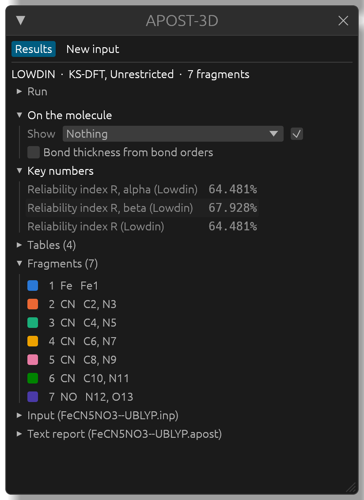
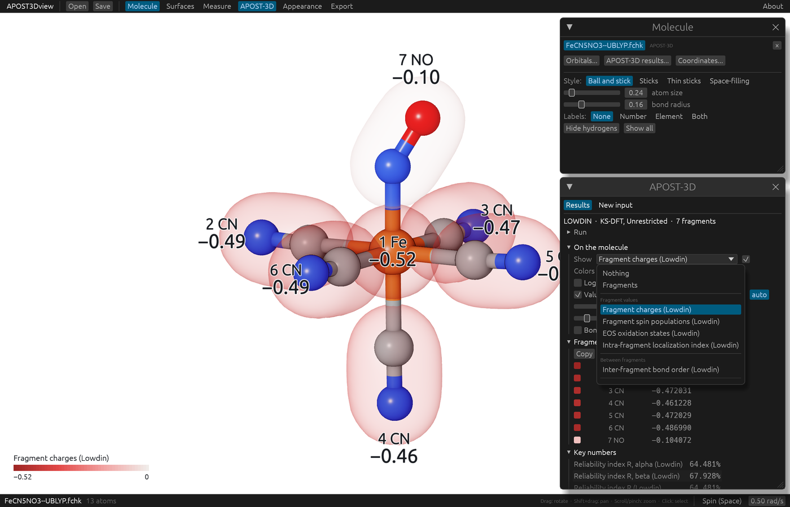

# APOST-3D results on the molecule

Every APOST-3D run writes a results file, `<job>.apost.json`, next to its text report `<job>.apost`. APOST3Dview reads that file (never the text report) and shows what is in it on the molecule, in tables, and in the **APOST-3D** window.

## Opening results

Open the `<job>.apost.json` file: its `.fchk` (the one APOST-3D read, in the same folder) opens with it, and the **APOST-3D** window opens with the results. If the `.fchk` is already open, the results are added to it.

Opening the `.fchk` instead shows the calculation alone. When its results are next to it, the **APOST-3D** window says so and offers **Open these results**.

Before showing anything, APOST3Dview checks that the results belong to this `.fchk`: the same atoms at the same positions, the same number of basis functions and the same SCF energy. Results of another calculation are refused, with a red **Results not loaded** box in the window that says what differs. Two other boxes can appear: one when APOST-3D stopped before the end of the run (with its message; what was written before the stop is still shown), and one when no `.fchk` was found next to the results (the geometry then comes from the results file, and orbitals aren't available).

## The APOST-3D window

From the top:

- **Results** and **New input**: the results, or an APOST-3D input for this `.fchk` (see [Making an APOST-3D input](input.md)).
- One line with the atomic definition, the wavefunction and the number of fragments, and **Run**, folded: the results file, the job, the APOST-3D version, when the run started, the wavefunction, the basis functions, the electrons, the energy and the analyses.
- **On the molecule**: what is drawn on the molecule (below).
- The values of what is shown, as a table, or for a pair quantity as a heat map with the strongest pairs.
- **Key numbers**: the run's single numbers, such as the reliability index R of the oxidation states.
- **Tables**: the tables of the analyses (EFOs, OSLOs, frontier occupations), one at a time.
- **Fragments**: the fragments as APOST-3D defined them, with their atoms. Click one to select its atoms in the view (<kbd>Cmd</kbd>-click or <kbd>Ctrl</kbd>-click adds them to the selection). Atoms in no fragment are named here, as a check that the fragments were defined as intended.
- **Input** and **Text report**: APOST-3D's input and its text report, as they are, with **Copy** and **Copy all**.

## What to show: the Show menu

At first nothing is drawn on the molecule. Choose what to show in **Show**, under **On the molecule**:

- *Fragments*: each fragment as a soft translucent envelope in its own color. The atoms keep their element colors.
- Any value APOST-3D computed. The menu groups them by where they live:
  - *Fragment values* and *Atom values*: one value on each fragment or atom, such as a charge, a spin population or an oxidation state. A fragment is colored by its value, an atom gets a colored halo.
  - *Between fragments* and *Between atoms*: one value for each pair, such as a bond order or an interaction energy.
  - *Energy decomposition (IQA)*, when the run has one (see [Energy decomposition (IQA)](results/iqa.md)).

The box next to **Show** hides what is shown without losing the choice.

Some values come from the diagonal or off-diagonal part of a matrix, and the menu names them by that: an *intra* value lies within one atom or fragment (the local spin, a localization index, a self-energy), an *inter* value lies between two (a bond order, a spin coupling, an interaction energy). When two matrices name a part the same way, the menu adds the matrix it comes from, as in *(exchange-only bond orders, TFVC)* and *(improved bond orders, TFVC)*.

Values that follow from others (electron populations and counts, valences, overlap populations) and the Mulliken values printed for comparison in a run with another atomic definition are left out; tick **Also list other values**, at the end of the menu, to list them too.

## Pair values: seen from one atom or fragment

A pair quantity, such as a bond order, can't be drawn on every pair at once in a readable way. APOST3Dview shows it from one atom or fragment at a time: that one is drawn in gold and named in **Seen from**, and every other one takes the color of its value with it. Click another atom or fragment in the view, or choose it in **Seen from**, to see the values from there. A click on a fragment in the **Fragments** list, or on a row of the heat map or of the strongest pairs, does the same.

## Colors, labels and the legend

- **Colors**: **Automatic** fits the scale to the values shown. **Fixed** keeps a range of your own for this quantity, in every open structure, so figures of different systems compare. Signed quantities (charges, spins, energies) use a red to blue scale through gray, others a gray to blue one.
- **Logarithmic colors**, for signed quantities: the colors follow the order of magnitude, so small values keep their sign's color next to large ones.
- **Values on the molecule** prints each value beside its atom or fragment, **with names** above it (atom names follow the **Labels:** setting of the **Molecule** window). **decimals** is **auto**, or a number you choose, and **label size** sets their size. Labels never overlap: in a crowded view, a label that would cover another moves a line up or down or is left out, and the label of an atom hidden behind others is left out. Every value is still in the window's tables, and turning or zooming the view brings labels back.
- **Bond thickness from bond orders** draws each bond by its bond order. It is off by default, since equal bonds usually look better in figures.

The legend in the corner names what is shown and gives the scale. It is drawn into exported images too, at the same size relative to the picture; **legend size** makes it larger for a figure printed small, such as one of three parts side by side on a page.

## Values as numbers

Below **On the molecule**, the values of what is shown are listed, with **Copy** (or **Copy matrix**) to paste them into a spreadsheet. For a matrix, a line says what its diagonal and its off-diagonal mean and gives its total; the heat map shows every pair (hover over a cell for its value, click it to see the molecule from its row), and **Strongest pairs** lists the pairs by size.

With two atoms selected, **Selected pair** lists every pair value APOST-3D computed for them.

## The analyses

- [Fragments, charges and bond orders](results/fragments.md)
- [Local spin](results/local-spin.md)
- [Energy decomposition (IQA)](results/iqa.md)
- [Effective fragment orbitals and OSLOs](results/efos-oslos.md)
