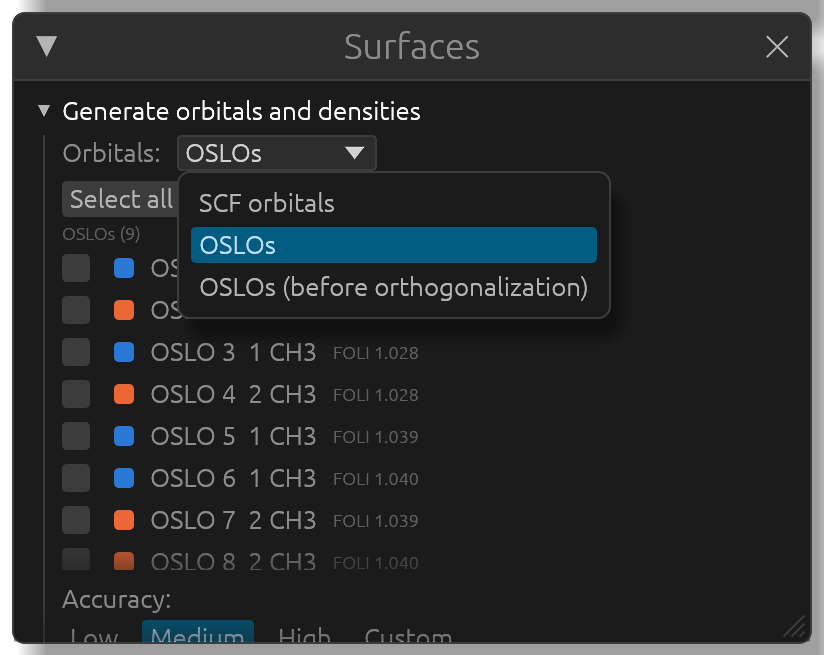
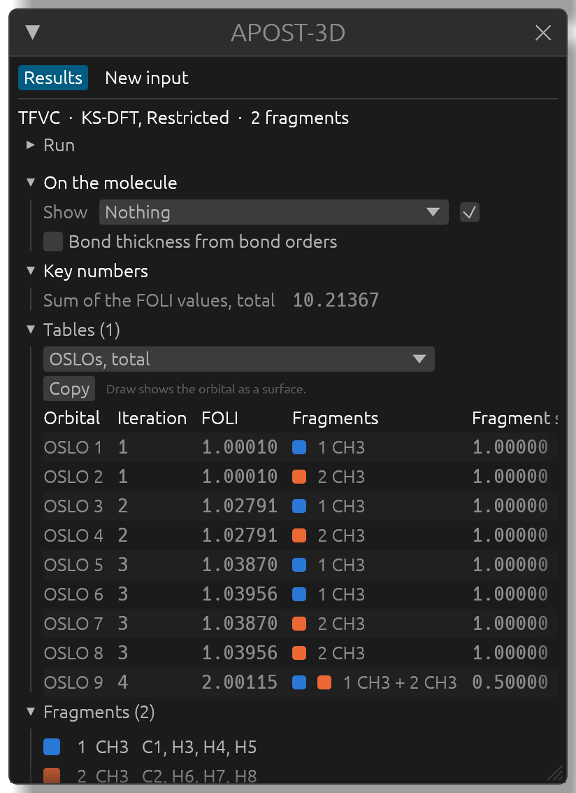
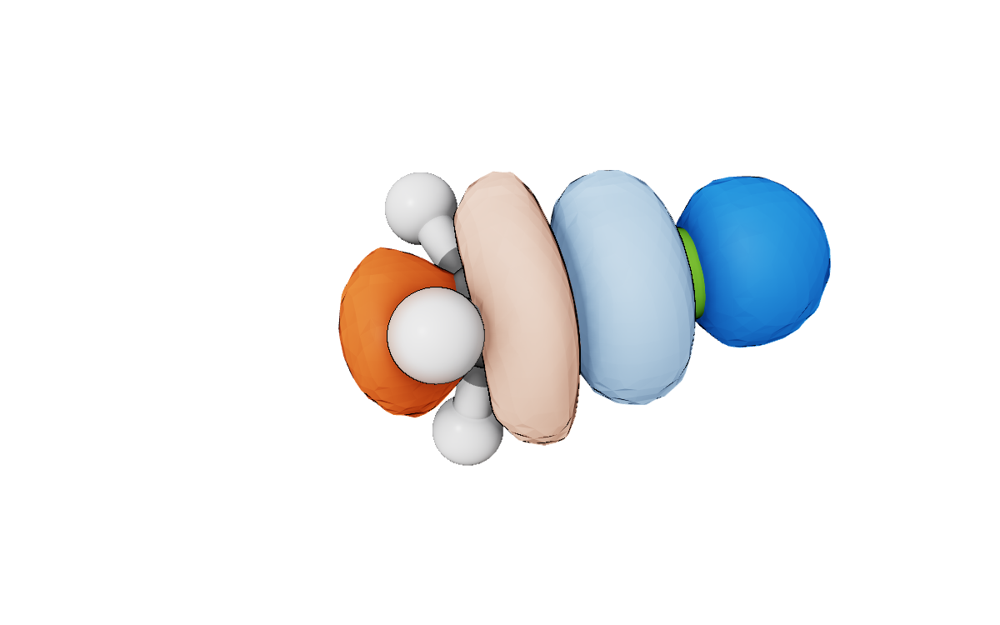

# Effective fragment orbitals and OSLOs

APOST-3D's oxidation state analyses work with orbitals of their own: the effective fragment orbitals (EFOs) of EOS and GEOS, and the oxidation states localized orbitals (OSLOs) of OSLO. APOST-3D writes them to an orbital file of their own next to the results (for example `<job>-OSLOs.fchk`), and APOST3Dview draws them like any other orbital, each named after its fragment.

This page uses two examples: `C2H6-OSLO-2CH3` (ethane, two CH3 fragments, OSLO) and `CH3F-GEOS` (fluoromethane, F and CH3, GEOS).

## The orbitals in the Surfaces window

Open `C2H6-OSLO-2CH3.apost.json`, then the **Surfaces** window. The **Orbitals:** menu at the top switches from *SCF orbitals* to the orbitals of the analyses in the run: *EOS EFOs*, *GEOS EFOs*, *OSLOs*, and *OSLOs (before orthogonalization)* when APOST-3D wrote them (these are the orbitals the FOLI values were computed for).

Only the orbitals the analysis describes are listed, each with its fragment (or the two fragments it is shared between, with their shares) and its numbers:

- EFOs: the occupation, the electrons assigned to it, and its fit (how closely the orbital stored in the file reproduces the EFO). Negative EFOs of GEOS are in italics.
- OSLOs: the FOLI value.

The lists are per spin channel when there are two: α and β for EOS, paired and unpaired for GEOS. Tick orbitals (**Select all** and **Clear** help), choose the grid as for any orbital, and generate them. They are named like "OSLO 9 · 1 CH3 + 2 CH3" or "EFO 3 α · 2 CN" in the list of surfaces.

### Exact EFOs and the fitted ones

APOST-3D writes the EFOs of EOS and GEOS to two orbital files. The first holds fits, in the basis set of the calculation, of each EFO times its fragment's atomic weight. A fit leaves small tails on the other fragments, which show up at low isovalues (0.02, say) as small extra lobes on atoms the EFO doesn't belong to. With TFVC, Becke or Becke-rho atoms APOST-3D also writes, since its results format 0.17, the *unweighted* EFOs: plain combinations of the basis functions which, times their fragment's weight, give each EFO exactly. That is what its cube files hold, and it is what APOST3Dview draws whenever that file is there: the weights are rebuilt from the results file, and the surfaces are those of the cube files, without writing cubes.

To see the orbitals of the first file exactly as stored, tails included, open **Advanced** under the list of EFOs and tick **Draw as stored in the .fchk**. The EFOs already drawn are redrawn either way, and sessions keep the choice.

Results written before format 0.17, and runs with Hirshfeld atoms, have only the fitted file. Their EFOs are drawn as stored, and the Surfaces window says so. An EFO with a fit below 60% is then marked *approximate*: the orbital in the file only roughly reproduces the EFO and can show lobes the exact one doesn't have. Hover over the mark for the reason. Running APOST-3D again (0.17 or later) gives the exact EFOs. With Mulliken, Löwdin and other Hilbert-space atoms the EFOs in the file are exact already, and OSLOs are exact localized orbitals.

## Drawing an orbital from its table

The **Tables** section of the **APOST-3D** window lists the tables of the analyses, one at a time from its menu: here, the OSLOs with their fragments and FOLI.

**Draw** on a row generates that orbital and shows it, in one click. **Copy** puts the table on the clipboard, for a spreadsheet. A table whose orbitals have no orbital file says so ("No orbital file for these orbitals."), as does one whose orbital file isn't next to the results.

## Colored by fragment

Orbitals are drawn in the usual positive and negative colors. With **Color by fragment** ticked (in the surface's settings, in the **Surfaces** window), an orbital is drawn in its fragment's color instead, the same color as in the **Fragments** list; an orbital shared by two fragments fades from one color to the other across the bond, and its negative lobe is a paler shade. This shows at a glance which fragment an orbital belongs to:

## Frontier EFOs and the reliability index

EOS assigns the electrons to the EFOs of all fragments in order of decreasing occupation. The frontier EFOs are the last occupied (LO) EFO and the first unoccupied (FU) EFO. The closer their occupations, the less clear-cut the assignment: the reliability index R = 100 · min(1, max(0, λLO − λFU + 0.5)) is 100% when they differ by more than half an electron, and 50% when they are equal.

In the **Surfaces** window, **Frontier** ticks the frontier EFOs of the set, in every channel: all of them when several are degenerate (two equivalent ligands, say). In the list they are marked **LO** and **FU**. Here, the frontier EFOs of CH3F's GEOS, colored by fragment: the last occupied one on F, the first unoccupied one on CH3.

**Key numbers** gives R (for each spin channel, and overall), and **Tables** has a table of the frontier EFOs of each fragment: the occupations of its last occupied and first unoccupied EFO. (R is computed from these per-fragment values: the FU EFO is the most occupied first unoccupied EFO of a fragment other than the LO EFO's, since moving an electron within a fragment doesn't change its oxidation state.)

Results files written before APOST-3D's results format 0.15 don't say which EFOs are the frontier ones; for them, **Frontier** isn't offered.

## Checks on the orbital files

An orbital file is read the first time its orbitals are needed, and checked against the open `.fchk` (the same atoms at the same positions, the same number of basis functions) and against the results (the same APOST-3D run). A file from another calculation or another run is refused, with the reason in the **Surfaces** window: run APOST-3D again to write it anew.
