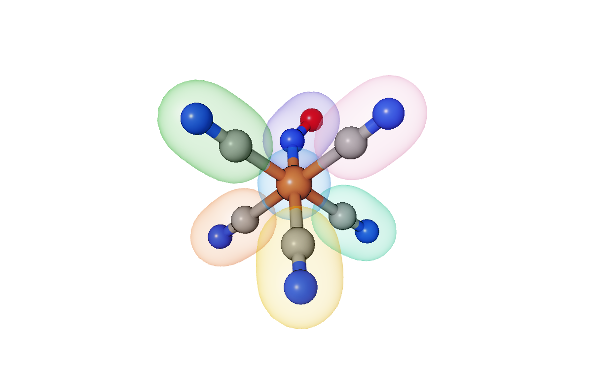
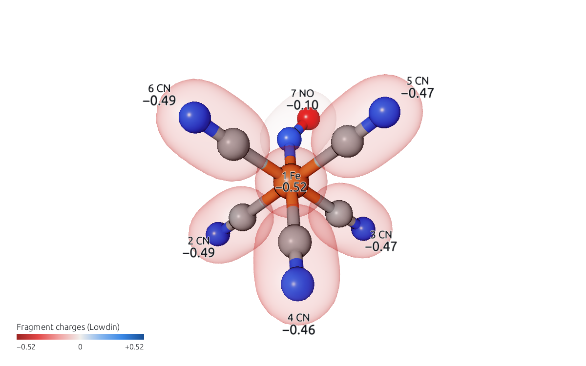
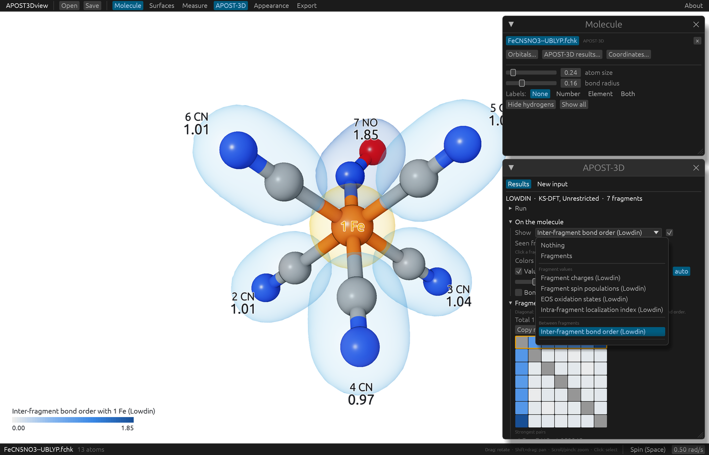
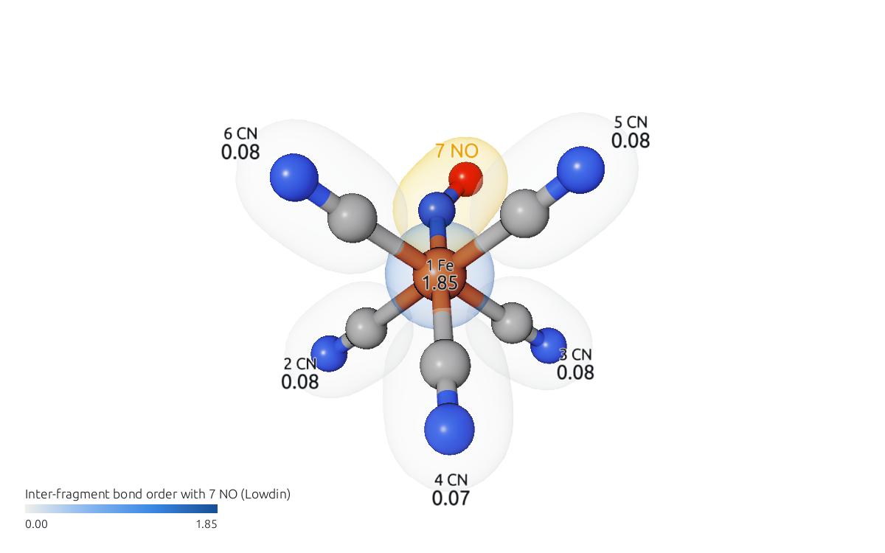

# Fragments, charges and bond orders

This page uses the example `FeCN5NO3--UBLYP` (in the `examples` folder): [Fe(CN)5NO]³⁻, a doublet at UBLYP/def2-SVP, analyzed with Löwdin atoms in seven fragments (Fe, five CN and NO), with EOS oxidation states. Open `FeCN5NO3--UBLYP.apost.json`.

## The fragments

In the **APOST-3D** window, choose *Fragments* in **Show**. Each fragment is drawn as a translucent envelope in its own color, the same color as its swatch in the **Fragments** list below; the atoms keep their element colors.

The **Fragments** list names the atoms of each fragment ("2 CN  C2, N3"). Clicking a fragment selects its atoms in the view, which is a quick way to check that the fragments are what you meant, or to hide one (**Hide selected** in the **Molecule** window).

## Values on the fragments

Under *Fragment values*, choose *Fragment charges (Lowdin)*. Each fragment's envelope takes the color of its charge, on a red (negative) to blue (positive) scale through gray, with the value beside it and the legend in the corner. *Fragment spin populations (Lowdin)* and *EOS oxidation states (Lowdin)* are next to it.

Values on atoms (*Atomic charges (Lowdin)* under *Atom values*) are drawn the same way, as a translucent halo around each atom.

Fragment values are APOST-3D's own fragment results: they are never made by adding up atom values in the viewer.

## Bond orders between fragments

Under *Between fragments*, choose *Inter-fragment bond order (Lowdin)*. The molecule is seen from the first fragment, Fe: it is drawn in gold and named in **Seen from**, and every other fragment takes the color of its bond order with Fe.

To see the bond orders from another fragment, click it in the view, choose it in **Seen from**, or click its row in the heat map. Here, from NO:

The window lists the whole matrix:

| What you want | Where |
|---|---|
| What the diagonal and off-diagonal mean, and the total | The line under the matrix's title |
| Every pair at a glance | The heat map: hover over a cell for its value, click it to look from its row |
| The strongest pairs | **Strongest pairs**, under the heat map |
| The matrix in a spreadsheet | **Copy matrix** |
| The same colors in another structure | **Colors**: **Fixed**, then the range |
| Bonds drawn by their bond order | **Bond thickness from bond orders** |

Bond orders between atoms are under *Between atoms*, and the localization index of each fragment (the diagonal of the same matrix) under *Fragment values*, as *Intra-fragment localization index (Lowdin)*.

## Oxidation states

*EOS oxidation states (Lowdin)*, under *Fragment values*, shows the effective oxidation state of each fragment. **Key numbers** gives the reliability index R of the assignment (for each spin, and overall), and **Tables** the effective fragment orbitals (EFOs) with their occupations. In this example the EFOs can't be drawn, because the folder doesn't hold their orbital file; the table says so. How to draw EFOs and OSLOs is in [Effective fragment orbitals and OSLOs](efos-oslos.md).
