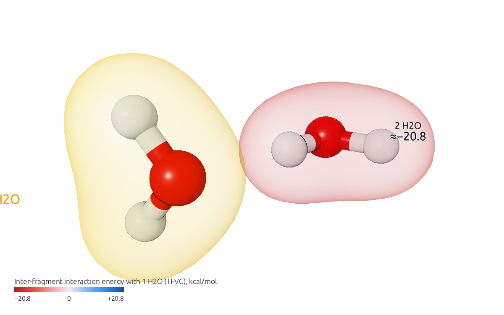
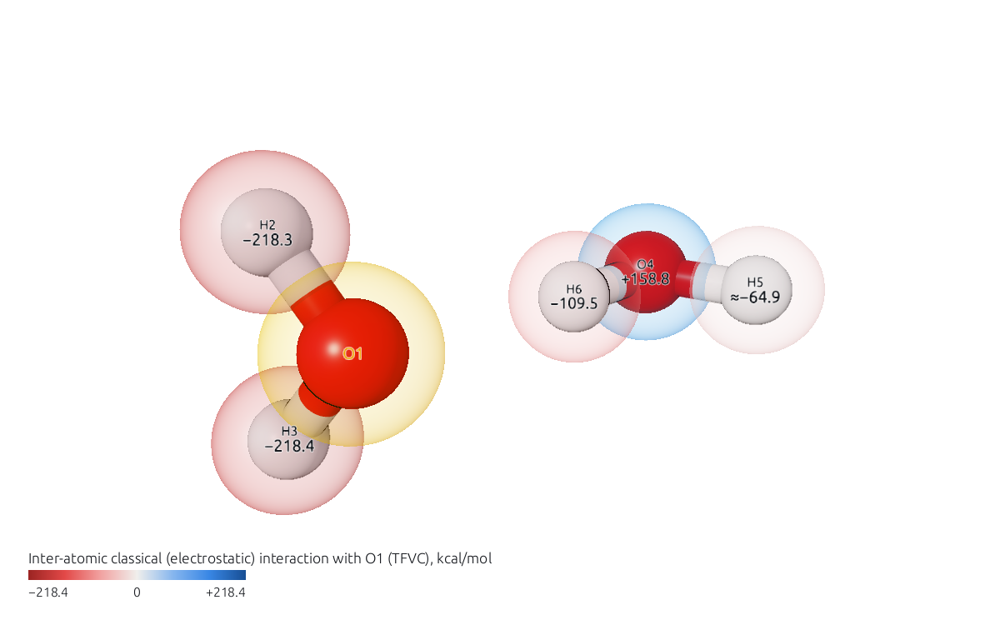
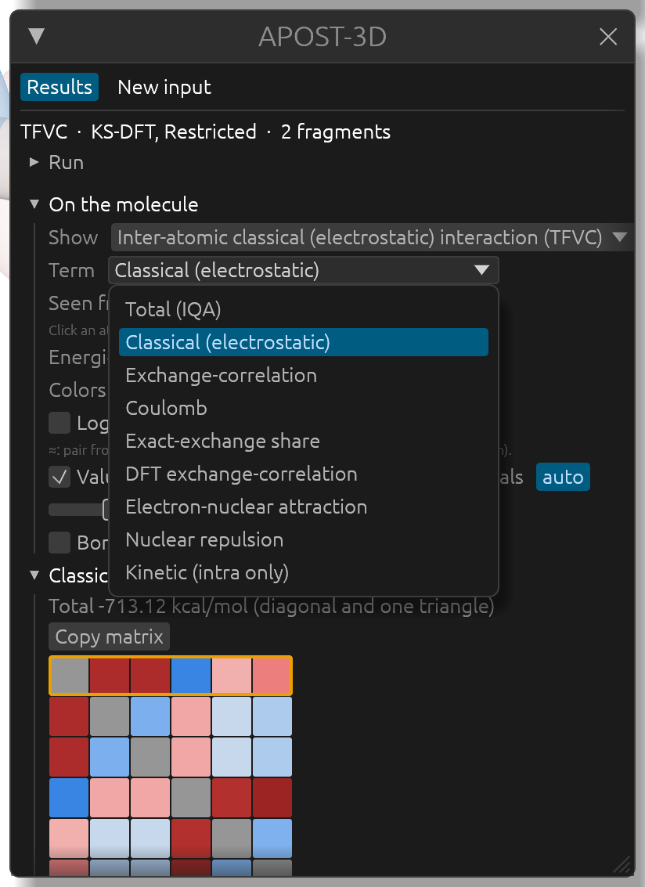

# Energy decomposition (IQA)

APOST-3D's energy decomposition (ENPART) splits the energy of the molecule into intra-atomic (self) energies and inter-atomic interaction energies, in the interacting quantum atoms (IQA) scheme, for Hartree-Fock, KS-DFT and correlated (CASSCF, CISD) wavefunctions. Each interaction is further split into terms: classical (electrostatic), exchange-correlation and its parts, and more.

This page uses the example `H2O-Dimer-B3LYP`: the water dimer at B3LYP/cc-pVDZ, with TFVC atoms and each water a fragment. Open `H2O-Dimer-B3LYP.apost.json`.

## Interaction energies

In the **APOST-3D** window, open **Show**: the group *Energy decomposition (IQA)* holds the interaction energies between fragments and between atoms. Choose *Inter-fragment interaction energy (TFVC)*: the molecule is seen from the first water, and the other one takes the color of their interaction energy, here the hydrogen bond, in kcal/mol. Negative values (attraction) are red, positive ones (repulsion) blue.

*Inter-atomic interaction energy (TFVC)* does the same between atoms. As for every pair quantity, click an atom in the view to see its interactions with the others.

Under **Show**, two more controls appear for an energy:

- **Term** chooses the term shown: *Total (IQA)*, *Classical (electrostatic)*, *Exchange-correlation*, its *Exchange* and *Correlation* parts when the run has them, *Coulomb*, and more. Here, the classical part of the interactions with O1:

  

- **Energies in** **kcal/mol** or **au**. The choice applies to the values on the molecule, the legend, the tables and the selected pair.

Interaction energies span orders of magnitude (a bonded pair against a distant one). **Logarithmic colors** makes the colors follow the order of magnitude, so a weak interaction still shows its sign's color next to a strong one; the legend then says "log scale".

A value marked with "≈" belongs to a pair whose exchange-correlation APOST-3D approximated with a multipolar expansion (pairs with a small bond order, by default); a note under the controls says so.

## One pair, term by term

Select two atoms (click one, then the other). **Selected pair** lists their interaction energy term by term, in the unit chosen, and says when the pair comes from the multipolar expansion.

## How well the decomposition adds up

The section **Energy decomposition (IQA)** in the **APOST-3D** window (its heading gives the final integration error) shows how the decomposition was done and how far its numbers can be trusted:

- **Method**: the wavefunction and, for DFT, the functional with its share of exact exchange.
- **Total energy (IQA)** and **Energy of the .fchk**, and the **Integration error** between them, with its one-electron (electron-nuclear, kinetic) and two-electron parts.
- The **zero-error correction** of the two-electron integration: applied, not needed, or not possible (when the `.fchk` lacks the reference energy components), with its details.
- **Multipolar pairs**: how many pairs come from the multipolar expansion, and which.

A value that deserves attention is shown in orange, with a line saying why: a final error above 1 kcal/mol without correction, a one-electron error above 0.1 kcal/mol, a first-grid two-electron error above 5 kcal/mol, or an unusual damping of the correction.

The same section lists the atomic and fragment energies as numbers: the **Intra-atomic (self) energy** of each atom (**Intra-fragment (self) energy** of each fragment) and its **Additive energy** (the self energy plus half of each of its interactions; the additive energies add up to the total energy), with **Copy**. They are dominated by the core electrons, which is why they are listed rather than drawn as colors (they are also in **Show**, under *Energy decomposition (IQA)*, as intra-atomic energies).
