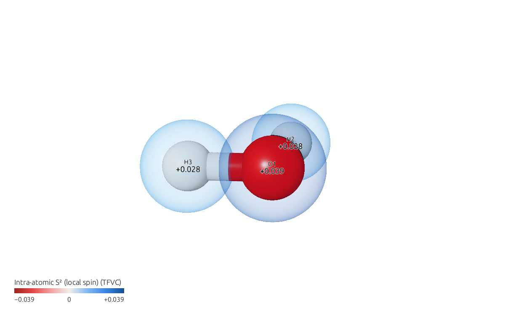

# Local spin

APOST-3D's local spin analysis (SPIN) splits the expectation value of S² into atomic or fragment contributions (the local spins, on the diagonal) and contributions of pairs (the spin couplings, off the diagonal). It tells unpaired electrons and their coupling apart from ordinary covalent bonding, also in a singlet described by a correlated wavefunction, where there is no spin density at all.

This page uses the example `H2O-CAS44`: water at CASSCF(4,4)/STO-3G, with TFVC atoms. Open `H2O-CAS44.apost.json`.

## Local spins

In the **APOST-3D** window, choose *Intra-atomic S² (local spin, TFVC)* under *Atom values* in **Show**. Each atom gets a halo in the color of its local spin, with the value beside it.

For fragments, the same is *Intra-fragment S² (local spin, TFVC)* under *Fragment values*.

## Spin couplings

The pairs are under *Between atoms* (or *Between fragments*), as *Inter-atomic S² (spin coupling, TFVC)*. As for every pair quantity, the molecule is seen from one atom at a time: click another atom to see its couplings. A negative coupling between two atoms with local spin points to antiferromagnetically coupled unpaired electrons, a positive one to a ferromagnetic coupling.

## Which wavefunctions

For a single determinant (Hartree-Fock or DFT), APOST-3D computes the local spin from the `.fchk` alone. For a correlated wavefunction it needs the density matrices of the calculation, which APOST-3D's `apost3d.py` script writes for PySCF (the `.dm1` and `.dm2` files next to the `.fchk`). The input APOST3Dview prepares for such a file asks for them; see [Making an APOST-3D input](../input.md).
