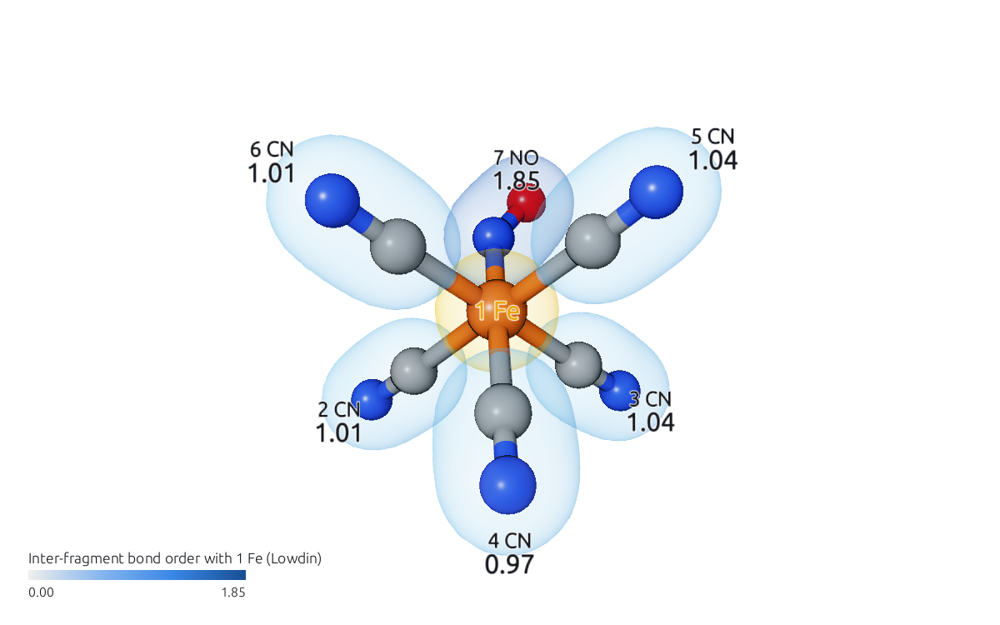
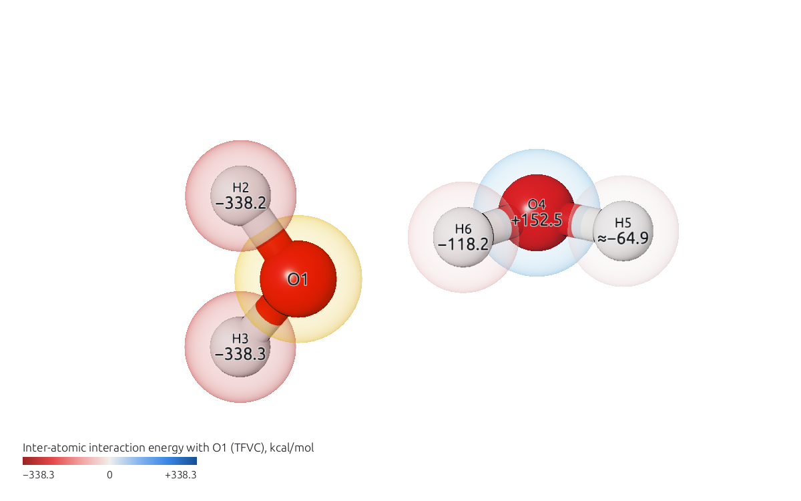
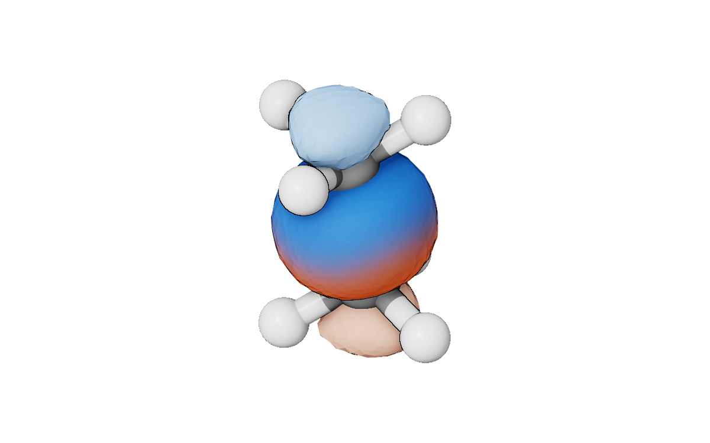
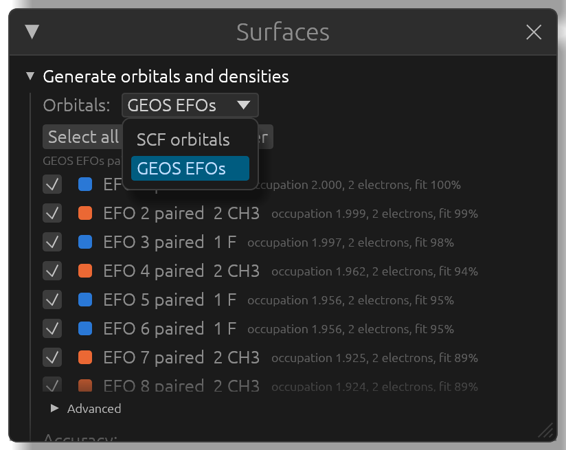
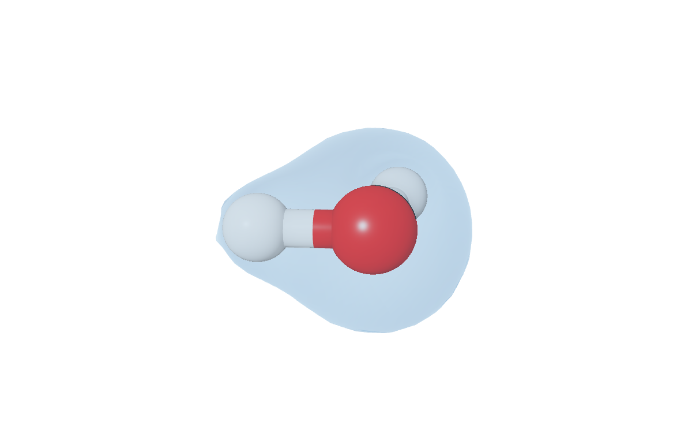

# A five-minute tour

Every download holds an `examples` folder with five complete APOST-3D calculations: each subfolder is one run, as APOST-3D leaves it (the input `.inp`, the wavefunction `.fchk`, the text report `.apost`, the results file `.apost.json`, and the orbital files some analyses write). They are also in the [source repository](https://github.com/mgimferrer/APOST3Dview/tree/main/examples).

To open one, open its `.apost.json` file (**Open**, or drag it onto the window). Its `.fchk` opens with it, and the **APOST-3D** window shows the results. Each section below takes a minute.

## Fragments and bond orders: FeCN5NO3--UBLYP

[Fe(CN)5NO]³⁻, a doublet at UBLYP/def2-SVP, analyzed with Löwdin atoms in seven fragments: Fe, five CN and NO.

In the **APOST-3D** window, open the **Show** menu and choose *Inter-fragment bond order (Lowdin)*. The molecule is now seen from Fe: each other fragment takes the color of its bond order with Fe, printed beside it, and the legend gives the scale. Click another fragment in the view to see the bond orders from there.

More in [Fragments, charges and bond orders](results/fragments.md).

## An energy decomposition: H2O-Dimer-B3LYP

The water dimer at B3LYP/cc-pVDZ, with TFVC atoms, each water a fragment, and APOST-3D's energy decomposition (IQA).

In **Show**, choose *Inter-atomic interaction energy (TFVC)*. The molecule is seen from O1: every other atom takes the color of its interaction energy with O1, in kcal/mol, red for attraction and blue for repulsion.

More in [Energy decomposition (IQA)](results/iqa.md).

## A shared OSLO in two colors: C2H6-OSLO-2CH3

Ethane at B3LYP/cc-pVTZ, with TFVC atoms, two CH3 fragments, and OSLO, which finds orbitals localized on one fragment or shared between two.

In the **APOST-3D** window, open **Tables (1)**: it lists the nine occupied OSLOs. Click **Draw** on the last one, OSLO 9, the C-C bond shared by the two CH3. Then, in the **Surfaces** window, tick **Color by fragment**: the orbital fades from one fragment's color to the other's across the bond.

More in [Effective fragment orbitals and OSLOs](results/efos-oslos.md).

## Effective fragment orbitals: CH3F-GEOS

Fluoromethane at BP86/def2-SVP, with TFVC atoms, F and CH3 as fragments, and GEOS oxidation states.

Open **Surfaces**, choose *GEOS EFOs* in the **Orbitals:** menu, click **Select all**, then **Generate**. Each orbital is listed with its fragment, its occupation and its fit. Click a name to show that orbital alone. The EFOs are drawn exactly, as in APOST-3D's cube files, not from the approximate projections that other programs show (see [Exact EFOs and the fitted ones](results/efos-oslos.md#exact-efos-and-the-fitted-ones)).

## A correlated density: H2O-CAS44

Water at CASSCF(4,4)/STO-3G, computed with PySCF, with TFVC atoms, the local spin and the energy decomposition of the correlated wavefunction.

Open **Surfaces**, tick **Total density**, and click **Generate 1 surface(s)**. The density drawn is the CASSCF density, which APOST3Dview evaluates from the density matrix stored in the `.fchk`; the total density starts translucent, so the molecule shows through.

More in [Orbitals and densities](orbitals.md).
